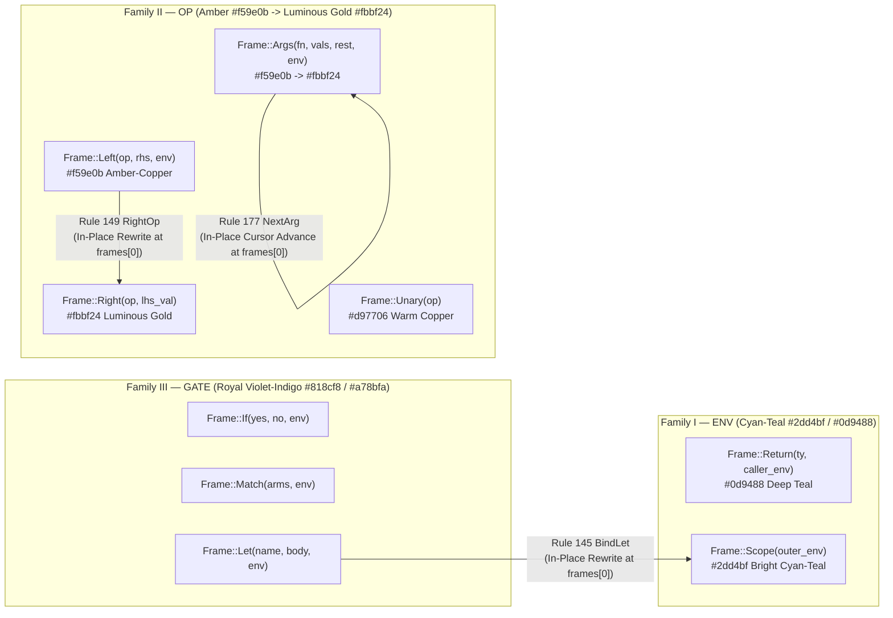

# Technical Design Study 02: The 9-Variant `Frame` Algebra, 3-Family Semiotics & In-Place Continuation Rewrites

**Profile:** `sherlock-k-a/1` (`K_SOURCE_SHA256 = b3746ff51dd7999b046ccb23237595605420adcfeebc0c04c0ad0f1396b11d41`)  
**Primary Sources:**
- [`reference_types.rs`](file:///home/charles/repos/Moriarty/crates/mori-core/src/sherlock/reference_types.rs#L101-L113) — Frozen 9-variant `Frame` algebra and top-first `Snapshot::frames: Vec<Frame>` representation.
- [`reference.rs`](file:///home/charles/repos/Moriarty/crates/mori-core/src/sherlock/reference.rs#L102-L294) — Charged transition rules (`transition`, `evaluate`, `return_value`) governing frame creation, admission, in-place mutation, and popping.
- [`designer2_well.js`](file:///home/charles/sherlock-bench/src/designers/designer2_well.js#L982-L1640) & [`designer3_frames.js`](file:///home/charles/sherlock-bench/src/designers/designer3_frames.js#L15-L555) — 6 Concentric Horological Depth Rings (`R1..R6`, 2 frames/ring = 12 Half-Ring Arcs `R1.A .. R6.B`) and Hollow Well Continuation Wafers.

---

## 1. Formal Algebra of the 9 `Frame` Variants in `sherlock-k-a/1`

In [`reference_types.rs`](file:///home/charles/repos/Moriarty/crates/mori-core/src/sherlock/reference_types.rs#L101-L113), the continuation stack of the Sherlock CEK machine is a homogeneous vector `frames: Vec<Frame>` over exactly **9 algebraic variants**:

```rust
#[derive(Clone, Debug, PartialEq, Eq)]
pub enum Frame {
    Let(Name, ExprRef, Environment),
    Left(BinaryOp, ExprRef, Environment),
    Right(BinaryOp, Value),
    Unary(UnaryOp),
    If(ExprRef, ExprRef, Environment),
    Match(Vec<Arm>, Environment),
    Args(Name, Vec<Value>, Vec<ExprRef>, Environment),
    Return(Type, Environment),
    Scope(Environment),
}
```

### 1.1 Two-Phase Frame Push Protocol (`Control::Push` $\to$ `Rule 135` / `Rule 140`)

No expression rule in `evaluate()` ([`reference.rs`](file:///home/charles/repos/Moriarty/crates/mori-core/src/sherlock/reference.rs#L161-L222)) or function/pattern rule in `transition()` ([`reference.rs`](file:///home/charles/repos/Moriarty/crates/mori-core/src/sherlock/reference.rs#L102-L159)) mutates `self.state.frames` directly. Instead, every frame-allocating rule constructs a transient `Control::Push(frame, Box<Control>, Environment)` state, which is adjudicated on the **next** charged step by `Rule 135` (`PushFrame`) or `Rule 140` (`FrameErr`):

```rust
Control::Push(frame, next, environment) => {
    if self.state.frames.len() < self.state.stack_limit {
        self.state.frames.insert(0, frame);
        self.state.environment = environment;
        (135, *next)
    } else {
        (140, Control::Error(4))
    }
}
```

### 1.2 Complete Lifecycle Matrix of All 9 `Frame` Variants

| # | Variant Signature | Semantic Family | Staging Rule (`Control::Push`) | Commit Rule | In-Place Rewrite Rule (`d` unchanged) | Pop / Consume Rule (`d -> d - 1`) | Fault Rule on Return | Saved `Environment`? |
| :- | :--- | :--- | :--- | :--- | :--- | :--- | :--- | :-: |
| **1** | `Frame::Return(Type, Environment)` | **I. `ENV`** | `L208` (`SchedBody`) | `L135` (`PushFrame`) | — | `L185` (`RetOk`) | `L190` (`RetErr` $\to$ `Error(6)`) | Yes (caller `env`) |
| **2** | `Frame::Scope(Environment)` | **I. `ENV`** | `L220` (`MatchBody`) *or* via `L145` | `L135` (`PushFrame`) *or* `L145` | Created in-place by `L145` (`BindLet`) | `L195` (`RestoreScope`) | — | Yes (outer `env`) |
| **3** | `Frame::Left(BinaryOp, ExprRef, Environment)` | **II. `OP`** | `L117` (`BinLeft`) | `L135` (`PushFrame`) | `L149` (`RightOp`: `Left` $\to$ `Right`) | Never popped directly (always rewrites to `Right`) | — | Yes (for `rhs`) |
| **4** | `Frame::Right(BinaryOp, Value)` | **II. `OP`** | Never pushed directly | Created in-place by `L149` | Created in-place by `L149` (`RightOp`) | `L153` (`BinPrim` $\to$ `PrimitiveResult`) | Via `L225` (`Error(10/11)`) | No (`rhs` already active) |
| **5** | `Frame::Unary(UnaryOp)` | **II. `OP`** | `L120` (`Unary`) | `L135` (`PushFrame`) | — | `L157` (`UnPrim` $\to$ `PrimitiveResult`) | Via `L225` (`Error(11)`) | No (stateless op) |
| **6** | `Frame::Args(Name, Vec<Value>, Vec<ExprRef>, Environment)` | **II. `OP`** | `L131` (`CallArgs`, arity $\ge 1$) | `L135` (`PushFrame`) | `L177` (`NextArg`: advances cursor) | `L181` (`FinishArgs` $\to$ `Invoke`) | — | Yes (for `rest` args) |
| **7** | `Frame::If(ExprRef, ExprRef, Environment)` | **III. `GATE`** | `L123` (`If`) | `L135` (`PushFrame`) | — | `L161` (`IfTrue`), `L165` (`IfFalse`) | `L169` (`IfErr` $\to$ `Error(5)`) | Yes (for branch) |
| **8** | `Frame::Match(Vec<Arm>, Environment)` | **III. `GATE`** | `L126` (`Match`) | `L135` (`PushFrame`) | — | `L173` (`StartCases` $\to$ `Cases`) | Via `L212` (`Error(9)`) | Yes (for `Cases`) |
| **9** | `Frame::Let(Name, ExprRef, Environment)` | **III. `GATE`** | `L114` (`Let`) | `L135` (`PushFrame`) | `L145` (`BindLet`: `Let` $\to$ `Scope`) | Never popped directly (always rewrites to `Scope`) | — | Yes (for `body`) |

> [!IMPORTANT]
> **Structural Asymmetric Invariants in `reference.rs`:**
> 1. **`Frame::Left` and `Frame::Let` never decrease `frames.len()`:** Neither has a `self.state.frames.remove(0)` path in `return_value()`. `Frame::Left` is **always** rewritten in-place into `Frame::Right` (`Rule 149`), and `Frame::Let` is **always** rewritten in-place into `Frame::Scope` (`Rule 145`).
> 2. **`Frame::Right` is never pushed by `Rule 135`:** It can only come into existence at `self.state.frames[0]` via the in-place rewrite `Rule 149` (`RightOp`).
> 3. **`Frame::Scope` has two distinct birth pathways:** It is pushed via `Control::Push` + `Rule 135` when entering a matched pattern arm body (`Rule 220 MatchBody`), **or** it mutates into existence in-place at `frames[0]` when `Frame::Let` receives its bound RHS value (`Rule 145 BindLet`).

---

## 2. Partition into 3 Semantic Families & Split-Arc Color Language

A binary color split ("Saved Environment vs Pending Operand") collapses 7 distinct continuation roles into a single undifferentiated gold tone and renders in-place transitions invisible. By inspecting what each `Frame` variant **waits for** and what **state invariant** it enforces when `return_value(value)` ([`reference.rs`](file:///home/charles/repos/Moriarty/crates/mori-core/src/sherlock/reference.rs#L224-L294)) delivers a `Value`, the 9 variants partition cleanly into **3 Semantic Families**:



---

### 2.1 Family I — `ENV`: Lexical & Call Boundary Guards (`Frame::Return`, `Frame::Scope`)

- **Members:**
  1. `Frame::Return(Type, Environment)` — Created by `Rule 208` (`SchedBody`) upon function entry after `bind(&function.parameters, &values)` succeeds (`Rule 204`). Preserves the caller's `Environment` and the function's return `Type` contract while the callee body evaluates in its isolated parameter environment.
  2. `Frame::Scope(Environment)` — Created either by `Rule 220` (`MatchBody` + `Rule 135`) when a pattern arm extends the lexical environment with destructured bindings (`h`, `t`, `l`, `r`, `x`), or in-place by `Rule 145` (`BindLet`) when a `let name = value in body` binding extends the current environment.
- **Defining Algebraic Property:**
  Both variants are **pure value pass-throughs** on normal return. When `Control::Return(v)` reaches `Frame::Return` (`Rule 185`) or `Frame::Scope` (`Rule 195`), the value `v` itself is **not** transformed (`Control::Return(value)` remains `Control::Return(value)`). Instead, the frame restores `self.state.environment = environment` (and in `Frame::Return`, asserts `has_type(&value, ty)` or faults with `Rule 190` $\to$ `Error(6)`).
- **Color & Material Semiotics:**
  - **Primary Palette:** **Cyan-Teal (`#2dd4bf` Bright Cyan-Teal for `Scope` / `#0d9488` Deep Horological Teal for `Return`)**.
  - **Visual Rationale:** Cyan-Teal acts as a cool, structural containment seal separating call activations and lexical scopes from active arithmetic/control computation. On the 6 concentric horological rings, every active recursive function call plants a Cyan-Teal `Return` half-arc (`Rn.A`) as its anchor.

---

### 2.2 Family II — `OP`: Value Accumulators & Pending ALU Continuations (`Frame::Left`, `Frame::Right`, `Frame::Unary`, `Frame::Args`)

- **Members:**
  1. `Frame::Left(BinaryOp, ExprRef, Environment)` — Pushed at `Rule 117` (`BinLeft`) + `Rule 135`. Holds the binary operator (`Add`, `Sub`, `Mul`, `Eq`, `Lt`, `Cons`, `Branch`), the unevaluated `right: ExprRef`, and the saved `Environment` while `left` evaluates (`[?] op rhs`).
  2. `Frame::Right(BinaryOp, Value)` — Rewritten in-place from `Frame::Left` at `Rule 149` (`RightOp`). Holds the binary operator and the **already-evaluated** left-hand `Value` (`lhs_val op [?]`) while `right` evaluates. Consumed at `Rule 153` (`BinPrim`), dispatching `binary_result(op, left, value)` to the `aux/2` ALU witness array.
  3. `Frame::Unary(UnaryOp)` — Pushed at `Rule 120` (`Unary`) + `Rule 135`. Holds `UnaryOp::Leaf` or `UnaryOp::Not` (`op([?])`) without needing a saved environment. Consumed at `Rule 157` (`UnPrim`).
  4. `Frame::Args(Name, Vec<Value>, Vec<ExprRef>, Environment)` — Pushed at `Rule 131` (`CallArgs`) + `Rule 135` for function calls with $\ge 1$ argument (note: 0-arg calls bypass `Frame::Args` via `Rule 129 Call0`). Accumulates evaluated argument values in `values: Vec<Value>` and drains `rest: Vec<ExprRef>` via `Rule 177` (`NextArg`) before popping at `Rule 181` (`FinishArgs` $\to$ `Control::Invoke(name, values)`).
- **Defining Algebraic Property:**
  Every variant in Family II represents an **incomplete algebraic term with a value hole `[?]`** that either accumulates `Value` operands (`Left` $\to$ `Right`, `Args` $\to$ `Args`) or immediately reduces `Value` operands into a primitive result (`Right` $\to$ `PrimitiveResult`, `Unary` $\to$ `PrimitiveResult`) or function invocation (`Args` $\to$ `Invoke`).
- **Color & Material Semiotics:**
  - **Stage 1 (Awaiting First/Next Sub-Expression — `Left`, `Unary`, `Args` initial):** **Warm Amber-Copper (`#f59e0b` / `#d97706`)**. Signifies an uncharged or partially filled operator waiting on an expression tree.
  - **Stage 2 (Left Operand Locked / Accumulator Advancing — `Right`, `Args` after `Rule 177`):** **Luminous Champagne Gold (`#fbbf24`)**. When `Rule 149` (`RightOp`) locks a concrete `Value` into `Frame::Right(op, value)`, the half-ring arc ignites from Amber-Copper (`#f59e0b`) to Luminous Gold (`#fbbf24`), visually encoding that the left operand is now crystallized in silicon and waiting only on the right-hand recursion!

---

### 2.3 Family III — `GATE`: Control-Flow, Pattern & Binding Dispatchers (`Frame::If`, `Frame::Match`, `Frame::Let`)

- **Members:**
  1. `Frame::If(ExprRef, ExprRef, Environment)` — Pushed at `Rule 123` (`If`) + `Rule 135`. Waits for a `Value::Bool(condition)` scrutinee; on return, restores `environment` and branches to `Control::Eval(yes)` (`Rule 161 IfTrue`) or `Control::Eval(no)` (`Rule 165 IfFalse`), or faults with `Rule 169` (`Error(5)`) if non-boolean.
  2. `Frame::Match(Vec<Arm>, Environment)` — Pushed at `Rule 126` (`Match`) + `Rule 135`. Waits for the ADT scrutinee (`Value::List`, `Value::Tree`, `Value::UInt`, `Value::Bool`); on return (`Rule 173 StartCases`), pops the frame, restores `environment`, and enters the sequential pattern scanner `Control::Cases(value, arms, environment)` (`Rules 212, 214, 217, 220`).
  3. `Frame::Let(Name, ExprRef, Environment)` — Pushed at `Rule 114` (`Let`) + `Rule 135`. Waits for the RHS binding value in `let name = rhs in body`; on return (`Rule 145 BindLet`), binds `name -> value` into `environment`, rewrites itself in-place into `Frame::Scope(environment)`, and dispatches `Control::Eval(body)`.
- **Defining Algebraic Property:**
  Unlike Family II (`OP`), Family III (`GATE`) variants **never perform ALU reduction or tuple accumulation**. Instead, they consume the returned `Value` as a **control/binding key** that selects or unlocks the next syntactic expression (`yes` vs `no`, `Arm` body, or `let` body) and re-enters `Control::Eval(...)` or `Control::Cases(...)`.
- **Color & Material Semiotics:**
  - **Primary Palette:** **Royal Violet-Indigo (`#818cf8` Indigo for `If`/`Let`, `#a78bfa` Luminous Violet for `Match`)**.
  - **Visual Rationale:** In both `fact(4)` (where `If` tests `n == 0` at the start of every call) and `sum_list([5, 8, 3])` (where `Match` inspects `xs` at the start of every call), `GATE` frames are transient control-flow prisms that flash Royal Violet on the leading-edge half-ring arc while their condition/scrutinee evaluates, before either popping (`If`, `Match`) or transmuting in-place into Cyan-Teal `Scope` (`Let`).

---

## 3. The 3 In-Place Frame Rewrites in `reference.rs` (`return_value()`)

In [`reference.rs` lines 224–294](file:///home/charles/repos/Moriarty/crates/mori-core/src/sherlock/reference.rs#L224-L294), the comment at line 225 explicitly highlights a critical machine property:

```rust
// The empty-stack return was already published by step. Replacements
// retain depth; only source rules with a stack rewrite to S pop it.
```

Out of the 12 transition branches inside `return_value()`, **8 branches pop `self.state.frames.remove(0)`** (`Rules 153, 157, 161, 165, 173, 181, 185, 195`), **2 branches fault** (`Rules 169, 190`), and **3 branches mutate `self.state.frames[0]` in-place without changing `self.state.frames.len()` (`depth()`)**:

### 3.1 In-Place Rewrite 1: `Rule 145` (`BindLet`) — Cross-Family Transmutation (`GATE` $\to$ `ENV`)

```rust
// reference.rs:228-233
Frame::Let(name, body, environment) => {
    self.state.frames[0] = Frame::Scope(environment.clone());
    self.state.environment = environment;
    self.state.environment.insert(name, value);
    (145, Control::Eval(body))
}
```
- **What Happens Algebraically:**
  - **Before `Rule 145`:** `frames[0]` is `Frame::Let(name, body, env_outer)` (Family III `GATE`, Royal Violet `#818cf8`), waiting at depth $d$ for the RHS expression of `let name = rhs in body` to finish evaluating.
  - **At `Rule 145`:** `Control::Return(value)` arrives. Instead of popping `Let` and pushing `Scope` (which would cost 2 steps and an extra `Rule 135` stack-limit check), `sherlock-k-a/1` overwrites `frames[0]` in-place with `Frame::Scope(env_outer.clone())` (Family I `ENV`, Cyan-Teal `#2dd4bf`), inserts `(name, value)` into `self.state.environment`, and immediately transitions to `Control::Eval(body)` at the **exact same stack depth $d$**.
- **Why It Was Previously Invisible:**
  - Any visualization that keys ring fill solely on `frames.len()` (`depth`) sees $d \to d$ ($\Delta d = 0$) and zero positional motion.
  - Worse, any visualization that collapses `Let` and `Right` into a generic color misses the **cross-family phase shift** from **Pending Lexical Gate (`#818cf8` Violet)** to **Active Lexical Scope Guard (`#2dd4bf` Cyan-Teal)**!
- **Split-Arc Ring Semiotic Signature:**
  - On the active frontier half-arc (`slot = d - 1`), `Rule 145` triggers an immediate **Violet (`#818cf8`) $\to$ Cyan-Teal (`#2dd4bf`) chromatic latch snap** accompanied by a torsional micro-impulse on that ring, visually announcing: *"RHS value bound into scope; this slot is now guarding the outer environment until `body` completes."*

### 3.2 In-Place Rewrite 2: `Rule 149` (`RightOp`) — Intra-Family Phase Ignition (`OP` Stage 1 $\to$ `OP` Stage 2)

```rust
// reference.rs:234-238
Frame::Left(op, right, environment) => {
    self.state.frames[0] = Frame::Right(op, value);
    self.state.environment = environment;
    (149, Control::Eval(right))
}
```
- **What Happens Algebraically:**
  - **Before `Rule 149`:** `frames[0]` is `Frame::Left(op, right, env)` (Family II `OP` Stage 1, Amber-Copper `#f59e0b`), representing `[?] op right` while the left operand evaluates.
  - **At `Rule 149`:** `Control::Return(value)` delivers the evaluated left operand (e.g., `Value::UInt(4)` in `4 * fact(n - 1)` or `Value::UInt(5)` in `5 + sum_list(t)`). `frames[0]` is overwritten in-place with `Frame::Right(op, value)` (Family II `OP` Stage 2, Luminous Gold `#fbbf24`), `self.state.environment` is restored to `env`, and control dispatches `Control::Eval(right)` at the **same stack depth $d$**.
- **Why It Was Previously Invisible:**
  - In `designer2_well.js` (`getFrameRoleHex`), `Left` and `Right` returned the exact same hex (`PALETTE.heatBright`), and `designer3_frames.js` mapped both to `HEX_PENDING_OPERAND` (`0xd4a24c`). Because `frames.len()` stays constant ($d \to d$), the ring arc showed **zero visual change** at the exact step where `n` was evaluated to `4` and locked into `4 * [?]`!
- **Split-Arc Ring Semiotic Signature:**
  - On the active frontier half-arc (`slot = d - 1`), `Rule 149` shifts the arc and its 3 hemisphere jewel latches from **Amber-Copper (`#f59e0b`)** to **Luminous Gold (`#fbbf24`)** with a high-contrast specular pulse. In recursive functions like `fact(4)` and `sum_list([5, 8, 3])`, this Luminous Gold half-arc remains locked on its ring for the entire duration of the recursive sub-call, acting as a glowing golden register holding the partial operand `4 * [?]`, `3 * [?]`, `2 * [?]`, `1 * [?]`.

### 3.3 In-Place Rewrite 3: `Rule 177` (`NextArg`) — Multi-Argument Cursor Ratchet (`OP` Accumulator Step)

```rust
// reference.rs:267-278
Frame::Args(name, mut values, mut rest, environment) => {
    values.push(value);
    self.state.environment = environment.clone();
    if rest.is_empty() {
        self.state.frames.remove(0);
        (181, Control::Invoke(name, values))
    } else {
        let next = rest.remove(0);
        self.state.frames[0] = Frame::Args(name, values, rest, environment);
        (177, Control::Eval(next))
    }
}
```
- **What Happens Algebraically:**
  - When a $k$-argument call `f(e_0, e_1, ..., e_{k-1})` ($k \ge 2$, such as `cube_plus(seed, 272)` in Preset 5 `lexical_let`) is dispatched at `Rule 131` (`CallArgs`) + `Rule 135`, `frames[0]` is initialized to `Frame::Args(f, [], [e_1, ..., e_{k-1}], env)` while `e_0` evaluates.
  - When `e_0` returns `v_0` and `rest` is non-empty, **`Rule 177` (`NextArg`)** pushes `v_0` into `values`, pops `e_1` from `rest`, and **rewrites `self.state.frames[0]` in-place** to `Frame::Args(f, [v_0], [e_2, ...], env)` at the same depth $d$, dispatching `Control::Eval(e_1)`.
  - Only when the final argument $e_{k-1}$ returns (`rest.is_empty()`) does `Rule 181` (`FinishArgs`) pop `Frame::Args` ($d \to d - 1$) and transition to `Control::Invoke(name, values)`.
- **Why It Was Previously Invisible:**
  - Neither `frames.len()` nor `frame.kind` (`'Args'`) changes on `Rule 177`! Only the internal tuple ratio `values.len() / (values.len() + rest.len())` advances (e.g., `cube_plus(0/1 args)` $\to$ `cube_plus(1/1 args)`).
- **Split-Arc Ring Semiotic Signature:**
  - The 3 hemisphere jewel latches (`k = 0, 1, 2` for Slot A or `k = 3, 4, 5` for Slot B) on each half-ring arc act as **progressive argument fill indicators**: on `Rule 131/135`, the first latch lights Amber (`#f59e0b`); on each `Rule 177` (`NextArg`) in-place rewrite, the evaluated latch shifts to Luminous Gold (`#fbbf24`) and the next latch ignites, ratcheting the ring's spring angle forward by a discrete escapement tick without changing stack depth $d$.

---

## 4. Split-Arc Ring Indexing: Why Chronological (Bottom-Up) Mapping Is Essential

### 4.1 The Top-First vs. Chronological Indexing Dichotomy

In [`reference_types.rs` line 156](file:///home/charles/repos/Moriarty/crates/mori-core/src/sherlock/reference_types.rs#L156), `Snapshot::frames` is stored **top-first**:
- `frames[0]` is always the **newest (innermost, active top-of-stack)** continuation frame.
- `frames[d - 1]` is always the **oldest (outermost root)** continuation frame pushed at the start of execution.

Notice how [`designer3_frames.js` line 448](file:///home/charles/sherlock-bench/src/designers/designer3_frames.js#L448) maps wafers chronologically (`const frame = rawAfterFrames[totalAfter - 1 - i]`), whereas [`designer2_well.js` lines 1585–1586](file:///home/charles/sherlock-bench/src/designers/designer2_well.js#L1585-L1586) previously indexed `frames[n * 2]` and `frames[n * 2 + 1]` directly:

| Property | Raw Top-First Indexing (`slot c = frames[c]`) | Chronological / Call-Tree Indexing (`slot c = frames[d - 1 - c]`) |
| :--- | :--- | :--- |
| **Location of Root Frame (`fact(4)` `Return`)** | Shifts outward on every push (`R1.A` $\to$ `R1.B` $\to$ `R2.A` ... $\to$ `R6.A`) | **Permanently anchored at `R1.A` (`c = 0`)** for the entire lifetime of `fact(4)` |
| **Location of Active Top-of-Stack (`frames[0]`)** | Always at `R1.A` (`c = 0`), forcing all other 11 arcs to shift on every push/pop | **Always at the leading-edge frontier arc `c = d - 1`** (`R1.A` $\to$ `R1.B` $\to$ ... $\to$ `R6.A`) |
| **Meaning of Ring $R_n$ (`n = 1..6`) in `fact(4)`** | Scrambled mixture of transient and persistent frames shifting every step | **1-to-1 Call Activation Ring:** `R1` = `fact(4)`, `R2` = `fact(3)`, `R3` = `fact(2)`, `R4` = `fact(1)`, `R5..R6` = `fact(0)` base case |
| **Alignment with Hollow Well Wafers (`designer3`)** | Inverted relative to `designer3_frames.js` | **100% aligned** with `designer3_frames.js` (`wafer[c]` $\leftrightarrow$ `arc[c]`) |

### 4.2 Geometry of the 12 Half-Ring Arcs (`R1.A, R1.B .. R6.A, R6.B`)

Each of the 6 Concentric Horological Depth Rings (`R1` outermost at `y = 0.06, outerR = 0.98` down to `R6` innermost at `y = -0.28, outerR = 0.50`) is divided into **2 Split-Arc Half-Rings (`Rn.A` and `Rn.B`)**, yielding **12 addressable continuation slots (`c = 0 .. 11`)**:

| Ring | Engraved Numeral | Elevation `y` | Radii (`innerR .. outerR`) | Half-Arc `Rn.A` (West / Front-Left, Latches `0..2`) | Half-Arc `Rn.B` (East / Back-Right, Latches `3..5`) | `fact(4)` Call Mapping |
| :-: | :-: | :-: | :-: | :--- | :--- | :--- |
| **R1** | `'02'` | `+0.060` | `0.898 .. 0.980` | **`R1.A`** (`c = 0`, Wafer 1) | **`R1.B`** (`c = 1`, Wafer 2) | **`fact(4)`** (`Return` + `Right(4 * ?)`) |
| **R2** | `'04'` | `-0.008` | `0.802 .. 0.884` | **`R2.A`** (`c = 2`, Wafer 3) | **`R2.B`** (`c = 3`, Wafer 4) | **`fact(3)`** (`Return` + `Right(3 * ?)`) |
| **R3** | `'06'` | `-0.076` | `0.706 .. 0.788` | **`R3.A`** (`c = 4`, Wafer 5) | **`R3.B`** (`c = 5`, Wafer 6) | **`fact(2)`** (`Return` + `Right(2 * ?)`) |
| **R4** | `'08'` | `-0.144` | `0.610 .. 0.692` | **`R4.A`** (`c = 6`, Wafer 7) | **`R4.B`** (`c = 7`, Wafer 8) | **`fact(1)`** (`Return` + `Right(1 * ?)`) |
| **R5** | `'10'` | `-0.212` | `0.514 .. 0.596` | **`R5.A`** (`c = 8`, Wafer 9) | **`R5.B`** (`c = 9`, Wafer 10) | **`fact(0)`** (`Return` + `If(? == 0)`) |
| **R6** | `'12'` | `-0.280` | `0.418 .. 0.500` | **`R6.A`** (`c = 10`, Wafer 11) | **`R6.B`** (`c = 11`, Wafer 12) | **Base Equality** (`Left/Right(0 == ?)`) |

---

## 5. Full Step-by-Step 12-Arc Trace I: `fact(4)` (145 Steps, `S000..S144`)

Program source (`Preset 1: Factorial(4)`):
```rust
program Factorial {
  fn fact(n: UInt): UInt {
    if n == 0 { 1 } else { n * fact(n - 1) }
  }
  entry fact(4);
}
```

### 5.1 Why `fact(4)` Is the Ultimate Horological Ring Benchmark

In `fact(4)`, every recursive activation `fact(k)` ($k \in \{4, 3, 2, 1\}$) executes an identical 28-step micro-cycle that uses **4 half-ring arcs during condition/argument evaluation** and then settles into **2 permanent half-ring arcs (`Rn.A` = `ENV` `Return`, `Rn.B` = `OP` `Right(k * ?)`)** before invoking `fact(k - 1)`:
1. **Call Entry:** `Rule 208` + `Rule 135` pushes `Return(: UInt, env_caller)` into **`Rn.A`** (`ENV` Teal `#0d9488`).
2. **Condition Test (`n == 0`):**
   - `Rule 123` + `Rule 135` pushes `If(1, n * fact(n-1), {n: k})` into **`Rn.B`** (`GATE` Violet `#818cf8`).
   - `Rule 117` + `Rule 135` pushes `Left([?] == 0, {n: k})` into **`R(n+1).A`** (`OP` Amber `#f59e0b`).
   - **`Rule 149` (`RightOp` In-Place Rewrite):** Rewrites **`R(n+1).A`** in-place from `Left([?] == 0)` (`#f59e0b` Amber) to `Right(k == [?])` (`#fbbf24` Luminous Gold) at constant depth!
   - `Rule 153` (`BinPrim`) pops **`R(n+1).A`**, and `Rule 165` (`IfFalse`) pops **`Rn.B`**, returning depth to $2n - 1$.
3. **Pending Multiply & Recursive Argument (`n * fact(n - 1)`):**
   - `Rule 117` + `Rule 135` pushes `Left([?] * fact(n-1), {n: k})` into **`Rn.B`** (`OP` Amber `#f59e0b`).
   - **`Rule 149` (`RightOp` In-Place Rewrite):** Evaluates `n` $\to k$ and rewrites **`Rn.B`** in-place into `Right(k * [?])` (`OP` Luminous Gold `#fbbf24`)! **`Rn.B` now stays locked in Luminous Gold until the unwind phase!**
   - `Rule 131` + `Rule 135` pushes `Args(fact, [], [], {n: k})` into **`R(n+1).A`** (`OP` Amber `#f59e0b`).
   - `Rule 117` + `Rule 135` pushes `Left([?] - 1, {n: k})` into **`R(n+1).B`** (`OP` Amber `#f59e0b`).
   - **`Rule 149` (`RightOp` In-Place Rewrite):** Rewrites **`R(n+1).B`** in-place into `Right(k - [?])` (`OP` Luminous Gold `#fbbf24`).
   - `Rule 153` (`BinPrim`) pops **`R(n+1).B`** (`k - 1`), and `Rule 181` (`FinishArgs`) pops **`R(n+1).A`**, invoking `fact(k - 1)` with Ring $R_n$ (`Rn.A` = Teal, `Rn.B` = Gold) completely locked!

### 5.2 Complete Step-by-Step 12-Arc Table for `fact(4)`

Legend for Arc Cells:
- **`ENV` (Cyan-Teal):** `Ret` = `Frame::Return(:UInt, env)` (`#0d9488`), `Scp` = `Frame::Scope(env)` (`#2dd4bf`)
- **`OP` Stage 1 (Amber `#f59e0b`):** `Args(fact)`, `L(?==0)`, `L(?*f)`, `L(?-1)`
- **`OP` Stage 2 (Luminous Gold `#fbbf24`, In-Place Rewritten):** **`R(k==?)`**, **`R(k*?)`**, **`R(k-?)`**
- **`GATE` (Violet `#818cf8`):** `If(?)` = `Frame::If(1, n*fact(n-1), env)`
- `·` = Empty arc (`#24252a` dark titanium channel)

| Step | Rule | Event / Transition | `d` | `R1.A` (`c=0`) | `R1.B` (`c=1`) | `R2.A` (`c=2`) | `R2.B` (`c=3`) | `R3.A` (`c=4`) | `R3.B` (`c=5`) | `R4.A` (`c=6`) | `R4.B` (`c=7`) | `R5.A` (`c=8`) | `R5.B` (`c=9`) | `R6.A` (`c=10`) | `R6.B` (`c=11`) |
| :-: | :-: | :--- | :-: | :-: | :-: | :-: | :-: | :-: | :-: | :-: | :-: | :-: | :-: | :-: | :-: |
| `S000` | `L131` | `CallArgs` `fact(4)` | `0` | `·` | `·` | `·` | `·` | `·` | `·` | `·` | `·` | `·` | `·` | `·` | `·` |
| `S001` | `L135` | **Push** `Args(fact)` | `1` | `Args` 🟠 | `·` | `·` | `·` | `·` | `·` | `·` | `·` | `·` | `·` | `·` | `·` |
| `S003` | `L181` | **Pop** `FinishArgs` $\to$ `Invoke(fact(4))` | `0` | `·` | `·` | `·` | `·` | `·` | `·` | `·` | `·` | `·` | `·` | `·` | `·` |
| `S007` | `L135` | **Push** `Return` (`fact(4)` entry) | `1` | `Ret` 🟢 | `·` | `·` | `·` | `·` | `·` | `·` | `·` | `·` | `·` | `·` | `·` |
| `S009` | `L135` | **Push** `If` (`n == 0` in `fact(4)`) | `2` | `Ret` 🟢 | `If(?)` 🟣 | `·` | `·` | `·` | `·` | `·` | `·` | `·` | `·` | `·` | `·` |
| `S011` | `L135` | **Push** `Left([?] == 0)` | `3` | `Ret` 🟢 | `If(?)` 🟣 | `L(?==0)` 🟠 | `·` | `·` | `·` | `·` | `·` | `·` | `·` | `·` | `·` |
| **`S013`** | **`L149`** | **IN-PLACE REWRITE** `Left` $\to$ `Right(4 == ?)` | **`3`** | `Ret` 🟢 | `If(?)` 🟣 | **`R(4==?)`** 🟡 | `·` | `·` | `·` | `·` | `·` | `·` | `·` | `·` | `·` |
| `S015` | `L153` | **Pop** `BinPrim` (`4 == 0` $\to$ `false`) | `2` | `Ret` 🟢 | `If(?)` 🟣 | `·` | `·` | `·` | `·` | `·` | `·` | `·` | `·` | `·` | `·` |
| `S017` | `L165` | **Pop** `IfFalse` $\to$ `n * fact(n-1)` | `1` | `Ret` 🟢 | `·` | `·` | `·` | `·` | `·` | `·` | `·` | `·` | `·` | `·` | `·` |
| `S019` | `L135` | **Push** `Left([?] * fact(n-1))` | `2` | `Ret` 🟢 | `L(?*f)` 🟠 | `·` | `·` | `·` | `·` | `·` | `·` | `·` | `·` | `·` | `·` |
| **`S021`** | **`L149`** | **IN-PLACE REWRITE** `Left` $\to$ `Right(4 * ?)` | **`2`** | `Ret` 🟢 | **`R(4*?)`** 🟡 | `·` | `·` | `·` | `·` | `·` | `·` | `·` | `·` | `·` | `·` |
| `S023` | `L135` | **Push** `Args(fact)` for `fact(n-1)` | `3` | `Ret` 🟢 | `R(4*?)` 🟡 | `Args` 🟠 | `·` | `·` | `·` | `·` | `·` | `·` | `·` | `·` | `·` |
| `S025` | `L135` | **Push** `Left([?] - 1)` | `4` | `Ret` 🟢 | `R(4*?)` 🟡 | `Args` 🟠 | `L(?-1)` 🟠 | `·` | `·` | `·` | `·` | `·` | `·` | `·` | `·` |
| **`S027`** | **`L149`** | **IN-PLACE REWRITE** `Left` $\to$ `Right(4 - ?)` | **`4`** | `Ret` 🟢 | `R(4*?)` 🟡 | `Args` 🟠 | **`R(4-?)`** 🟡 | `·` | `·` | `·` | `·` | `·` | `·` | `·` | `·` |
| `S029` | `L153` | **Pop** `BinPrim` (`4 - 1` $\to$ `3`) | `3` | `Ret` 🟢 | `R(4*?)` 🟡 | `Args` 🟠 | `·` | `·` | `·` | `·` | `·` | `·` | `·` | `·` | `·` |
| `S031` | `L181` | **Pop** `FinishArgs` $\to$ `Invoke(fact(3))` | `2` | `Ret` 🟢 | `R(4*?)` 🟡 | `·` | `·` | `·` | `·` | `·` | `·` | `·` | `·` | `·` | `·` |
| `S035` | `L135` | **Push** `Return` (`fact(3)` entry) | `3` | `Ret` 🟢 | `R(4*?)` 🟡 | `Ret` 🟢 | `·` | `·` | `·` | `·` | `·` | `·` | `·` | `·` | `·` |
| `S037` | `L135` | **Push** `If` (`n == 0` in `fact(3)`) | `4` | `Ret` 🟢 | `R(4*?)` 🟡 | `Ret` 🟢 | `If(?)` 🟣 | `·` | `·` | `·` | `·` | `·` | `·` | `·` | `·` |
| `S039` | `L135` | **Push** `Left([?] == 0)` | `5` | `Ret` 🟢 | `R(4*?)` 🟡 | `Ret` 🟢 | `If(?)` 🟣 | `L(?==0)` 🟠 | `·` | `·` | `·` | `·` | `·` | `·` | `·` |
| **`S041`** | **`L149`** | **IN-PLACE REWRITE** `Left` $\to$ `Right(3 == ?)` | **`5`** | `Ret` 🟢 | `R(4*?)` 🟡 | `Ret` 🟢 | `If(?)` 🟣 | **`R(3==?)`** 🟡 | `·` | `·` | `·` | `·` | `·` | `·` | `·` |
| `S043` | `L153` | **Pop** `BinPrim` (`3 == 0` $\to$ `false`) | `4` | `Ret` 🟢 | `R(4*?)` 🟡 | `Ret` 🟢 | `If(?)` 🟣 | `·` | `·` | `·` | `·` | `·` | `·` | `·` | `·` |
| `S045` | `L165` | **Pop** `IfFalse` $\to$ `n * fact(n-1)` | `3` | `Ret` 🟢 | `R(4*?)` 🟡 | `Ret` 🟢 | `·` | `·` | `·` | `·` | `·` | `·` | `·` | `·` | `·` |
| `S047` | `L135` | **Push** `Left([?] * fact(n-1))` | `4` | `Ret` 🟢 | `R(4*?)` 🟡 | `Ret` 🟢 | `L(?*f)` 🟠 | `·` | `·` | `·` | `·` | `·` | `·` | `·` | `·` |
| **`S049`** | **`L149`** | **IN-PLACE REWRITE** `Left` $\to$ `Right(3 * ?)` | **`4`** | `Ret` 🟢 | `R(4*?)` 🟡 | `Ret` 🟢 | **`R(3*?)`** 🟡 | `·` | `·` | `·` | `·` | `·` | `·` | `·` | `·` |
| `S051` | `L135` | **Push** `Args(fact)` for `fact(n-1)` | `5` | `Ret` 🟢 | `R(4*?)` 🟡 | `Ret` 🟢 | `R(3*?)` 🟡 | `Args` 🟠 | `·` | `·` | `·` | `·` | `·` | `·` | `·` |
| `S053` | `L135` | **Push** `Left([?] - 1)` | `6` | `Ret` 🟢 | `R(4*?)` 🟡 | `Ret` 🟢 | `R(3*?)` 🟡 | `Args` 🟠 | `L(?-1)` 🟠 | `·` | `·` | `·` | `·` | `·` | `·` |
| **`S055`** | **`L149`** | **IN-PLACE REWRITE** `Left` $\to$ `Right(3 - ?)` | **`6`** | `Ret` 🟢 | `R(4*?)` 🟡 | `Ret` 🟢 | `R(3*?)` 🟡 | `Args` 🟠 | **`R(3-?)`** 🟡 | `·` | `·` | `·` | `·` | `·` | `·` |
| `S057` | `L153` | **Pop** `BinPrim` (`3 - 1` $\to$ `2`) | `5` | `Ret` 🟢 | `R(4*?)` 🟡 | `Ret` 🟢 | `R(3*?)` 🟡 | `Args` 🟠 | `·` | `·` | `·` | `·` | `·` | `·` | `·` |
| `S059` | `L181` | **Pop** `FinishArgs` $\to$ `Invoke(fact(2))` | `4` | `Ret` 🟢 | `R(4*?)` 🟡 | `Ret` 🟢 | `R(3*?)` 🟡 | `·` | `·` | `·` | `·` | `·` | `·` | `·` | `·` |
| `S063` | `L135` | **Push** `Return` (`fact(2)` entry) | `5` | `Ret` 🟢 | `R(4*?)` 🟡 | `Ret` 🟢 | `R(3*?)` 🟡 | `Ret` 🟢 | `·` | `·` | `·` | `·` | `·` | `·` | `·` |
| `S065` | `L135` | **Push** `If` (`n == 0` in `fact(2)`) | `6` | `Ret` 🟢 | `R(4*?)` 🟡 | `Ret` 🟢 | `R(3*?)` 🟡 | `Ret` 🟢 | `If(?)` 🟣 | `·` | `·` | `·` | `·` | `·` | `·` |
| `S067` | `L135` | **Push** `Left([?] == 0)` | `7` | `Ret` 🟢 | `R(4*?)` 🟡 | `Ret` 🟢 | `R(3*?)` 🟡 | `Ret` 🟢 | `If(?)` 🟣 | `L(?==0)` 🟠 | `·` | `·` | `·` | `·` | `·` |
| **`S069`** | **`L149`** | **IN-PLACE REWRITE** `Left` $\to$ `Right(2 == ?)` | **`7`** | `Ret` 🟢 | `R(4*?)` 🟡 | `Ret` 🟢 | `R(3*?)` 🟡 | `Ret` 🟢 | `If(?)` 🟣 | **`R(2==?)`** 🟡 | `·` | `·` | `·` | `·` | `·` |
| `S071` | `L153` | **Pop** `BinPrim` (`2 == 0` $\to$ `false`) | `6` | `Ret` 🟢 | `R(4*?)` 🟡 | `Ret` 🟢 | `R(3*?)` 🟡 | `Ret` 🟢 | `If(?)` 🟣 | `·` | `·` | `·` | `·` | `·` | `·` |
| `S073` | `L165` | **Pop** `IfFalse` $\to$ `n * fact(n-1)` | `5` | `Ret` 🟢 | `R(4*?)` 🟡 | `Ret` 🟢 | `R(3*?)` 🟡 | `Ret` 🟢 | `·` | `·` | `·` | `·` | `·` | `·` | `·` |
| `S075` | `L135` | **Push** `Left([?] * fact(n-1))` | `6` | `Ret` 🟢 | `R(4*?)` 🟡 | `Ret` 🟢 | `R(3*?)` 🟡 | `Ret` 🟢 | `L(?*f)` 🟠 | `·` | `·` | `·` | `·` | `·` | `·` |
| **`S077`** | **`L149`** | **IN-PLACE REWRITE** `Left` $\to$ `Right(2 * ?)` | **`6`** | `Ret` 🟢 | `R(4*?)` 🟡 | `Ret` 🟢 | `R(3*?)` 🟡 | `Ret` 🟢 | **`R(2*?)`** 🟡 | `·` | `·` | `·` | `·` | `·` | `·` |
| `S079` | `L135` | **Push** `Args(fact)` for `fact(n-1)` | `7` | `Ret` 🟢 | `R(4*?)` 🟡 | `Ret` 🟢 | `R(3*?)` 🟡 | `Ret` 🟢 | `R(2*?)` 🟡 | `Args` 🟠 | `·` | `·` | `·` | `·` | `·` |
| `S081` | `L135` | **Push** `Left([?] - 1)` | `8` | `Ret` 🟢 | `R(4*?)` 🟡 | `Ret` 🟢 | `R(3*?)` 🟡 | `Ret` 🟢 | `R(2*?)` 🟡 | `Args` 🟠 | `L(?-1)` 🟠 | `·` | `·` | `·` | `·` |
| **`S083`** | **`L149`** | **IN-PLACE REWRITE** `Left` $\to$ `Right(2 - ?)` | **`8`** | `Ret` 🟢 | `R(4*?)` 🟡 | `Ret` 🟢 | `R(3*?)` 🟡 | `Ret` 🟢 | `R(2*?)` 🟡 | `Args` 🟠 | **`R(2-?)`** 🟡 | `·` | `·` | `·` | `·` |
| `S085` | `L153` | **Pop** `BinPrim` (`2 - 1` $\to$ `1`) | `7` | `Ret` 🟢 | `R(4*?)` 🟡 | `Ret` 🟢 | `R(3*?)` 🟡 | `Ret` 🟢 | `R(2*?)` 🟡 | `Args` 🟠 | `·` | `·` | `·` | `·` | `·` |
| `S087` | `L181` | **Pop** `FinishArgs` $\to$ `Invoke(fact(1))` | `6` | `Ret` 🟢 | `R(4*?)` 🟡 | `Ret` 🟢 | `R(3*?)` 🟡 | `Ret` 🟢 | `R(2*?)` 🟡 | `·` | `·` | `·` | `·` | `·` | `·` |
| `S091` | `L135` | **Push** `Return` (`fact(1)` entry) | `7` | `Ret` 🟢 | `R(4*?)` 🟡 | `Ret` 🟢 | `R(3*?)` 🟡 | `Ret` 🟢 | `R(2*?)` 🟡 | `Ret` 🟢 | `·` | `·` | `·` | `·` | `·` |
| `S093` | `L135` | **Push** `If` (`n == 0` in `fact(1)`) | `8` | `Ret` 🟢 | `R(4*?)` 🟡 | `Ret` 🟢 | `R(3*?)` 🟡 | `Ret` 🟢 | `R(2*?)` 🟡 | `Ret` 🟢 | `If(?)` 🟣 | `·` | `·` | `·` | `·` |
| `S095` | `L135` | **Push** `Left([?] == 0)` | `9` | `Ret` 🟢 | `R(4*?)` 🟡 | `Ret` 🟢 | `R(3*?)` 🟡 | `Ret` 🟢 | `R(2*?)` 🟡 | `Ret` 🟢 | `If(?)` 🟣 | `L(?==0)` 🟠 | `·` | `·` | `·` |
| **`S097`** | **`L149`** | **IN-PLACE REWRITE** `Left` $\to$ `Right(1 == ?)` | **`9`** | `Ret` 🟢 | `R(4*?)` 🟡 | `Ret` 🟢 | `R(3*?)` 🟡 | `Ret` 🟢 | `R(2*?)` 🟡 | `Ret` 🟢 | `If(?)` 🟣 | **`R(1==?)`** 🟡 | `·` | `·` | `·` |
| `S099` | `L153` | **Pop** `BinPrim` (`1 == 0` $\to$ `false`) | `8` | `Ret` 🟢 | `R(4*?)` 🟡 | `Ret` 🟢 | `R(3*?)` 🟡 | `Ret` 🟢 | `R(2*?)` 🟡 | `Ret` 🟢 | `If(?)` 🟣 | `·` | `·` | `·` | `·` |
| `S101` | `L165` | **Pop** `IfFalse` $\to$ `n * fact(n-1)` | `7` | `Ret` 🟢 | `R(4*?)` 🟡 | `Ret` 🟢 | `R(3*?)` 🟡 | `Ret` 🟢 | `R(2*?)` 🟡 | `Ret` 🟢 | `·` | `·` | `·` | `·` | `·` |
| `S103` | `L135` | **Push** `Left([?] * fact(n-1))` | `8` | `Ret` 🟢 | `R(4*?)` 🟡 | `Ret` 🟢 | `R(3*?)` 🟡 | `Ret` 🟢 | `R(2*?)` 🟡 | `Ret` 🟢 | `L(?*f)` 🟠 | `·` | `·` | `·` | `·` |
| **`S105`** | **`L149`** | **IN-PLACE REWRITE** `Left` $\to$ `Right(1 * ?)` | **`8`** | `Ret` 🟢 | `R(4*?)` 🟡 | `Ret` 🟢 | `R(3*?)` 🟡 | `Ret` 🟢 | `R(2*?)` 🟡 | `Ret` 🟢 | **`R(1*?)`** 🟡 | `·` | `·` | `·` | `·` |
| `S107` | `L135` | **Push** `Args(fact)` for `fact(n-1)` | `9` | `Ret` 🟢 | `R(4*?)` 🟡 | `Ret` 🟢 | `R(3*?)` 🟡 | `Ret` 🟢 | `R(2*?)` 🟡 | `Ret` 🟢 | `R(1*?)` 🟡 | `Args` 🟠 | `·` | `·` | `·` |
| `S109` | `L135` | **Push** `Left([?] - 1)` | `10` | `Ret` 🟢 | `R(4*?)` 🟡 | `Ret` 🟢 | `R(3*?)` 🟡 | `Ret` 🟢 | `R(2*?)` 🟡 | `Ret` 🟢 | `R(1*?)` 🟡 | `Args` 🟠 | `L(?-1)` 🟠 | `·` | `·` |
| **`S111`** | **`L149`** | **IN-PLACE REWRITE** `Left` $\to$ `Right(1 - ?)` | **`10`** | `Ret` 🟢 | `R(4*?)` 🟡 | `Ret` 🟢 | `R(3*?)` 🟡 | `Ret` 🟢 | `R(2*?)` 🟡 | `Ret` 🟢 | `R(1*?)` 🟡 | `Args` 🟠 | **`R(1-?)`** 🟡 | `·` | `·` |
| `S113` | `L153` | **Pop** `BinPrim` (`1 - 1` $\to$ `0`) | `9` | `Ret` 🟢 | `R(4*?)` 🟡 | `Ret` 🟢 | `R(3*?)` 🟡 | `Ret` 🟢 | `R(2*?)` 🟡 | `Ret` 🟢 | `R(1*?)` 🟡 | `Args` 🟠 | `·` | `·` | `·` |
| `S115` | `L181` | **Pop** `FinishArgs` $\to$ `Invoke(fact(0))` | `8` | `Ret` 🟢 | `R(4*?)` 🟡 | `Ret` 🟢 | `R(3*?)` 🟡 | `Ret` 🟢 | `R(2*?)` 🟡 | `Ret` 🟢 | `R(1*?)` 🟡 | `·` | `·` | `·` | `·` |
| `S119` | `L135` | **Push** `Return` (`fact(0)` entry) | `9` | `Ret` 🟢 | `R(4*?)` 🟡 | `Ret` 🟢 | `R(3*?)` 🟡 | `Ret` 🟢 | `R(2*?)` 🟡 | `Ret` 🟢 | `R(1*?)` 🟡 | `Ret` 🟢 | `·` | `·` | `·` |
| `S121` | `L135` | **Push** `If` (`n == 0` in `fact(0)`) | `10` | `Ret` 🟢 | `R(4*?)` 🟡 | `Ret` 🟢 | `R(3*?)` 🟡 | `Ret` 🟢 | `R(2*?)` 🟡 | `Ret` 🟢 | `R(1*?)` 🟡 | `Ret` 🟢 | `If(?)` 🟣 | `·` | `·` |
| `S123` | `L135` | **Push** `Left([?] == 0)` (Peak `d = 11`) | `11` | `Ret` 🟢 | `R(4*?)` 🟡 | `Ret` 🟢 | `R(3*?)` 🟡 | `Ret` 🟢 | `R(2*?)` 🟡 | `Ret` 🟢 | `R(1*?)` 🟡 | `Ret` 🟢 | `If(?)` 🟣 | `L(?==0)` 🟠 | `·` |
| **`S125`** | **`L149`** | **IN-PLACE REWRITE** `Left` $\to$ `Right(0 == ?)` | **`11`** | `Ret` 🟢 | `R(4*?)` 🟡 | `Ret` 🟢 | `R(3*?)` 🟡 | `Ret` 🟢 | `R(2*?)` 🟡 | `Ret` 🟢 | `R(1*?)` 🟡 | `Ret` 🟢 | `If(?)` 🟣 | **`R(0==?)`** 🟡 | `·` |
| `S127` | `L153` | **Pop** `BinPrim` (`0 == 0` $\to$ `true`) | `10` | `Ret` 🟢 | `R(4*?)` 🟡 | `Ret` 🟢 | `R(3*?)` 🟡 | `Ret` 🟢 | `R(2*?)` 🟡 | `Ret` 🟢 | `R(1*?)` 🟡 | `Ret` 🟢 | `If(?)` 🟣 | `·` | `·` |
| `S129` | `L161` | **Pop** `IfTrue` $\to$ `Eval(1)` (Base Case!) | `9` | `Ret` 🟢 | `R(4*?)` 🟡 | `Ret` 🟢 | `R(3*?)` 🟡 | `Ret` 🟢 | `R(2*?)` 🟡 | `Ret` 🟢 | `R(1*?)` 🟡 | `Ret` 🟢 | `·` | `·` | `·` |
| `S131` | `L185` | **Pop** `RetOk` (`fact(0)` returns `1`) | `8` | `Ret` 🟢 | `R(4*?)` 🟡 | `Ret` 🟢 | `R(3*?)` 🟡 | `Ret` 🟢 | `R(2*?)` 🟡 | `Ret` 🟢 | `R(1*?)` 🟡 | `·` | `·` | `·` | `·` |
| `S132` | `L153` | **Pop** `BinPrim` (`1 * 1` $\to$ `1`) | `7` | `Ret` 🟢 | `R(4*?)` 🟡 | `Ret` 🟢 | `R(3*?)` 🟡 | `Ret` 🟢 | `R(2*?)` 🟡 | `Ret` 🟢 | `·` | `·` | `·` | `·` | `·` |
| `S134` | `L185` | **Pop** `RetOk` (`fact(1)` returns `1`) | `6` | `Ret` 🟢 | `R(4*?)` 🟡 | `Ret` 🟢 | `R(3*?)` 🟡 | `Ret` 🟢 | `R(2*?)` 🟡 | `·` | `·` | `·` | `·` | `·` | `·` |
| `S135` | `L153` | **Pop** `BinPrim` (`2 * 1` $\to$ `2`) | `5` | `Ret` 🟢 | `R(4*?)` 🟡 | `Ret` 🟢 | `R(3*?)` 🟡 | `Ret` 🟢 | `·` | `·` | `·` | `·` | `·` | `·` | `·` |
| `S137` | `L185` | **Pop** `RetOk` (`fact(2)` returns `2`) | `4` | `Ret` 🟢 | `R(4*?)` 🟡 | `Ret` 🟢 | `R(3*?)` 🟡 | `·` | `·` | `·` | `·` | `·` | `·` | `·` | `·` |
| `S138` | `L153` | **Pop** `BinPrim` (`3 * 2` $\to$ `6`) | `3` | `Ret` 🟢 | `R(4*?)` 🟡 | `Ret` 🟢 | `·` | `·` | `·` | `·` | `·` | `·` | `·` | `·` | `·` |
| `S140` | `L185` | **Pop** `RetOk` (`fact(3)` returns `6`) | `2` | `Ret` 🟢 | `R(4*?)` 🟡 | `·` | `·` | `·` | `·` | `·` | `·` | `·` | `·` | `·` | `·` |
| `S141` | `L153` | **Pop** `BinPrim` (`4 * 6` $\to$ `24`) | `1` | `Ret` 🟢 | `·` | `·` | `·` | `·` | `·` | `·` | `·` | `·` | `·` | `·` | `·` |
| `S143` | `L185` | **Pop** `RetOk` (`fact(4)` returns `24`) | `0` | `·` | `·` | `·` | `·` | `·` | `·` | `·` | `·` | `·` | `·` | `·` | `·` |
| `S144` | `L080` | **Done(`24`)** (Emerald `outputWave` pulse) | `0` | `·` | `·` | `·` | `·` | `·` | `·` | `·` | `·` | `·` | `·` | `·` | `·` |

> [!TIP]
> **Look at the Unwind Cascade (`S129..S143`) in the Table Above:**
> At `S129`, Rings `R1..R4` hold an alternating **Teal / Gold / Teal / Gold / Teal / Gold / Teal / Gold** pattern (`Ret`, `R(4*?)`, `Ret`, `R(3*?)`, `Ret`, `R(2*?)`, `Ret`, `R(1*?)`). Then from `S131` to `S143`, the stack unwinds strictly from `R5.A` down to `R1.A`—one Gold `BinPrim` (`L153`) followed by one Teal `RetOk` (`L185`) per ring—until `R1.A` pops at `S143` and `Done(24)` fires at `S144`!

---

## 6. Full Step-by-Step 12-Arc Trace II: `sum_list([5, 8, 3])` (112 Steps, `S000..S111`)

Program source (`Preset 2: List Pattern Fold`):
```rust
program ListFold {
  fn sum_list(xs: List): UInt {
    match xs {
      nil => 0,
      cons(h, t) => h + sum_list(t)
    }
  }
  entry sum_list(cons(5, cons(8, cons(3, nil))));
}
```

### 6.1 Two-Act Horological Structure of `sum_list([5, 8, 3])`

Unlike `fact(4)` (whose entry argument `4` is an immediate literal), `sum_list(cons(5, cons(8, cons(3, nil))))` unfolds in **two distinct visual acts** across the 12 Half-Ring Arcs:
- **Act I — Cons-Spine Argument Construction (`S000..S021`, Rings `R1..R2`):**
  Before `sum_list` is even invoked, `R1.A` holds `Args(sum_list)` while `R1.B`, `R2.A`, and `R2.B` push `Left([?] cons ...)` (`#f59e0b` Amber) and rewrite in-place via `Rule 149` (`RightOp`) into `Right(5 cons ?)`, `Right(8 cons ?)`, and `Right(3 cons ?)` (`#fbbf24` Luminous Gold), which then fold right-to-left (`[3]` $\to$ `[8, 3]` $\to$ `[5, 8, 3]`) and pop back to depth `0` at `S021`!
- **Act II — Recursive Pattern-Match Folding (`S025..S111`, Rings `R1..R6`):**
  Each recursive call `sum_list(xs)` on a `cons(h, t)` cell leaves **3 persistent frames (1.5 Rings)** on the stack:
  1. `Frame::Return(: UInt, caller_env)` (`ENV` Deep Teal `#0d9488`) pushed at `Rule 208` + `Rule 135`.
  2. `Frame::Scope(match_env)` (`ENV` Bright Cyan-Teal `#2dd4bf`) pushed at `Rule 220` (`MatchBody`) + `Rule 135` (occupying the exact same half-arc slot just vacated by `Frame::Match` (`GATE` Violet `#a78bfa`) at `Rule 173` (`StartCases`)!).
  3. `Frame::Left([?] + sum_list(t))` (`OP` Amber `#f59e0b`) rewritten in-place at `Rule 149` (`RightOp`) into `Frame::Right(h + [?])` (`OP` Luminous Gold `#fbbf24`).

### 6.2 Complete Step-by-Step 12-Arc Table for `sum_list([5, 8, 3])`

| Step | Rule | Event / Transition | `d` | `R1.A` (`c=0`) | `R1.B` (`c=1`) | `R2.A` (`c=2`) | `R2.B` (`c=3`) | `R3.A` (`c=4`) | `R3.B` (`c=5`) | `R4.A` (`c=6`) | `R4.B` (`c=7`) | `R5.A` (`c=8`) | `R5.B` (`c=9`) | `R6.A` (`c=10`) | `R6.B` (`c=11`) |
| :-: | :-: | :--- | :-: | :-: | :-: | :-: | :-: | :-: | :-: | :-: | :-: | :-: | :-: | :-: | :-: |
| `S001` | `L135` | **Push** `Args(sum_list)` (Act I) | `1` | `Args` 🟠 | `·` | `·` | `·` | `·` | `·` | `·` | `·` | `·` | `·` | `·` | `·` |
| `S003` | `L135` | **Push** `Left(? cons (8..))` | `2` | `Args` 🟠 | `L(?::)` 🟠 | `·` | `·` | `·` | `·` | `·` | `·` | `·` | `·` | `·` | `·` |
| **`S005`** | **`L149`** | **IN-PLACE REWRITE** `Right(5 cons ?)` | **`2`** | `Args` 🟠 | **`R(5::?)`** 🟡 | `·` | `·` | `·` | `·` | `·` | `·` | `·` | `·` | `·` | `·` |
| `S007` | `L135` | **Push** `Left(? cons (3..))` | `3` | `Args` 🟠 | `R(5::?)` 🟡 | `L(?::)` 🟠 | `·` | `·` | `·` | `·` | `·` | `·` | `·` | `·` | `·` |
| **`S009`** | **`L149`** | **IN-PLACE REWRITE** `Right(8 cons ?)` | **`3`** | `Args` 🟠 | `R(5::?)` 🟡 | **`R(8::?)`** 🟡 | `·` | `·` | `·` | `·` | `·` | `·` | `·` | `·` | `·` |
| `S011` | `L135` | **Push** `Left(? cons [])` | `4` | `Args` 🟠 | `R(5::?)` 🟡 | `R(8::?)` 🟡 | `L(?::)` 🟠 | `·` | `·` | `·` | `·` | `·` | `·` | `·` | `·` |
| **`S013`** | **`L149`** | **IN-PLACE REWRITE** `Right(3 cons ?)` | **`4`** | `Args` 🟠 | `R(5::?)` 🟡 | `R(8::?)` 🟡 | **`R(3::?)`** 🟡 | `·` | `·` | `·` | `·` | `·` | `·` | `·` | `·` |
| `S015` | `L153` | **Pop** `BinPrim` (`3 cons []` $\to$ `[3]`) | `3` | `Args` 🟠 | `R(5::?)` 🟡 | `R(8::?)` 🟡 | `·` | `·` | `·` | `·` | `·` | `·` | `·` | `·` | `·` |
| `S017` | `L153` | **Pop** `BinPrim` (`8 cons [3]` $\to$ `[8,3]`) | `2` | `Args` 🟠 | `R(5::?)` 🟡 | `·` | `·` | `·` | `·` | `·` | `·` | `·` | `·` | `·` | `·` |
| `S019` | `L153` | **Pop** `BinPrim` (`5::[8,3]` $\to$ `[5,8,3]`) | `1` | `Args` 🟠 | `·` | `·` | `·` | `·` | `·` | `·` | `·` | `·` | `·` | `·` | `·` |
| `S021` | `L181` | **Pop** `FinishArgs` $\to$ `Invoke(sum_list)` | `0` | `·` | `·` | `·` | `·` | `·` | `·` | `·` | `·` | `·` | `·` | `·` | `·` |
| `S025` | `L135` | **Push** `Return` (`sum_list([5,8,3])`) | `1` | `Ret` 🟢 | `·` | `·` | `·` | `·` | `·` | `·` | `·` | `·` | `·` | `·` | `·` |
| `S027` | `L135` | **Push** `Match(2 arms)` (`GATE` Violet) | `2` | `Ret` 🟢 | `Match` 🟣 | `·` | `·` | `·` | `·` | `·` | `·` | `·` | `·` | `·` | `·` |
| `S029` | `L173` | **Pop** `StartCases` (`Cases([5,8,3])`) | `1` | `Ret` 🟢 | `·` | `·` | `·` | `·` | `·` | `·` | `·` | `·` | `·` | `·` | `·` |
| `S034` | `L135` | **Push** `Scope` (`cons` hit: `h=5, t=[8,3]`) | `2` | `Ret` 🟢 | `Scp` 🟢 | `·` | `·` | `·` | `·` | `·` | `·` | `·` | `·` | `·` | `·` |
| `S036` | `L135` | **Push** `Left([?] + sum_list(t))` | `3` | `Ret` 🟢 | `Scp` 🟢 | `L(?+f)` 🟠 | `·` | `·` | `·` | `·` | `·` | `·` | `·` | `·` | `·` |
| **`S038`** | **`L149`** | **IN-PLACE REWRITE** `Right(5 + ?)` | **`3`** | `Ret` 🟢 | `Scp` 🟢 | **`R(5+?)`** 🟡 | `·` | `·` | `·` | `·` | `·` | `·` | `·` | `·` | `·` |
| `S040` | `L135` | **Push** `Args(sum_list)` for `t` | `4` | `Ret` 🟢 | `Scp` 🟢 | `R(5+?)` 🟡 | `Args` 🟠 | `·` | `·` | `·` | `·` | `·` | `·` | `·` | `·` |
| `S042` | `L181` | **Pop** `FinishArgs` $\to$ `sum_list([8,3])` | `3` | `Ret` 🟢 | `Scp` 🟢 | `R(5+?)` 🟡 | `·` | `·` | `·` | `·` | `·` | `·` | `·` | `·` | `·` |
| `S046` | `L135` | **Push** `Return` (`sum_list([8,3])`) | `4` | `Ret` 🟢 | `Scp` 🟢 | `R(5+?)` 🟡 | `Ret` 🟢 | `·` | `·` | `·` | `·` | `·` | `·` | `·` | `·` |
| `S048` | `L135` | **Push** `Match(2 arms)` (`GATE` Violet) | `5` | `Ret` 🟢 | `Scp` 🟢 | `R(5+?)` 🟡 | `Ret` 🟢 | `Match` 🟣 | `·` | `·` | `·` | `·` | `·` | `·` | `·` |
| `S050` | `L173` | **Pop** `StartCases` (`Cases([8,3])`) | `4` | `Ret` 🟢 | `Scp` 🟢 | `R(5+?)` 🟡 | `Ret` 🟢 | `·` | `·` | `·` | `·` | `·` | `·` | `·` | `·` |
| `S055` | `L135` | **Push** `Scope` (`cons` hit: `h=8, t=[3]`) | `5` | `Ret` 🟢 | `Scp` 🟢 | `R(5+?)` 🟡 | `Ret` 🟢 | `Scp` 🟢 | `·` | `·` | `·` | `·` | `·` | `·` | `·` |
| `S057` | `L135` | **Push** `Left([?] + sum_list(t))` | `6` | `Ret` 🟢 | `Scp` 🟢 | `R(5+?)` 🟡 | `Ret` 🟢 | `Scp` 🟢 | `L(?+f)` 🟠 | `·` | `·` | `·` | `·` | `·` | `·` |
| **`S059`** | **`L149`** | **IN-PLACE REWRITE** `Right(8 + ?)` | **`6`** | `Ret` 🟢 | `Scp` 🟢 | `R(5+?)` 🟡 | `Ret` 🟢 | `Scp` 🟢 | **`R(8+?)`** 🟡 | `·` | `·` | `·` | `·` | `·` | `·` |
| `S061` | `L135` | **Push** `Args(sum_list)` for `t` | `7` | `Ret` 🟢 | `Scp` 🟢 | `R(5+?)` 🟡 | `Ret` 🟢 | `Scp` 🟢 | `R(8+?)` 🟡 | `Args` 🟠 | `·` | `·` | `·` | `·` | `·` |
| `S063` | `L181` | **Pop** `FinishArgs` $\to$ `sum_list([3])` | `6` | `Ret` 🟢 | `Scp` 🟢 | `R(5+?)` 🟡 | `Ret` 🟢 | `Scp` 🟢 | `R(8+?)` 🟡 | `·` | `·` | `·` | `·` | `·` | `·` |
| `S067` | `L135` | **Push** `Return` (`sum_list([3])`) | `7` | `Ret` 🟢 | `Scp` 🟢 | `R(5+?)` 🟡 | `Ret` 🟢 | `Scp` 🟢 | `R(8+?)` 🟡 | `Ret` 🟢 | `·` | `·` | `·` | `·` | `·` |
| `S069` | `L135` | **Push** `Match(2 arms)` (`GATE` Violet) | `8` | `Ret` 🟢 | `Scp` 🟢 | `R(5+?)` 🟡 | `Ret` 🟢 | `Scp` 🟢 | `R(8+?)` 🟡 | `Ret` 🟢 | `Match` 🟣 | `·` | `·` | `·` | `·` |
| `S071` | `L173` | **Pop** `StartCases` (`Cases([3])`) | `7` | `Ret` 🟢 | `Scp` 🟢 | `R(5+?)` 🟡 | `Ret` 🟢 | `Scp` 🟢 | `R(8+?)` 🟡 | `Ret` 🟢 | `·` | `·` | `·` | `·` | `·` |
| `S076` | `L135` | **Push** `Scope` (`cons` hit: `h=3, t=[]`) | `8` | `Ret` 🟢 | `Scp` 🟢 | `R(5+?)` 🟡 | `Ret` 🟢 | `Scp` 🟢 | `R(8+?)` 🟡 | `Ret` 🟢 | `Scp` 🟢 | `·` | `·` | `·` | `·` |
| `S078` | `L135` | **Push** `Left([?] + sum_list(t))` | `9` | `Ret` 🟢 | `Scp` 🟢 | `R(5+?)` 🟡 | `Ret` 🟢 | `Scp` 🟢 | `R(8+?)` 🟡 | `Ret` 🟢 | `Scp` 🟢 | `L(?+f)` 🟠 | `·` | `·` | `·` |
| **`S080`** | **`L149`** | **IN-PLACE REWRITE** `Right(3 + ?)` | **`9`** | `Ret` 🟢 | `Scp` 🟢 | `R(5+?)` 🟡 | `Ret` 🟢 | `Scp` 🟢 | `R(8+?)` 🟡 | `Ret` 🟢 | `Scp` 🟢 | **`R(3+?)`** 🟡 | `·` | `·` | `·` |
| `S082` | `L135` | **Push** `Args(sum_list)` for `t` | `10` | `Ret` 🟢 | `Scp` 🟢 | `R(5+?)` 🟡 | `Ret` 🟢 | `Scp` 🟢 | `R(8+?)` 🟡 | `Ret` 🟢 | `Scp` 🟢 | `R(3+?)` 🟡 | `Args` 🟠 | `·` | `·` |
| `S084` | `L181` | **Pop** `FinishArgs` $\to$ `sum_list([])` | `9` | `Ret` 🟢 | `Scp` 🟢 | `R(5+?)` 🟡 | `Ret` 🟢 | `Scp` 🟢 | `R(8+?)` 🟡 | `Ret` 🟢 | `Scp` 🟢 | `R(3+?)` 🟡 | `·` | `·` | `·` |
| `S088` | `L135` | **Push** `Return` (`sum_list([])`) | `10` | `Ret` 🟢 | `Scp` 🟢 | `R(5+?)` 🟡 | `Ret` 🟢 | `Scp` 🟢 | `R(8+?)` 🟡 | `Ret` 🟢 | `Scp` 🟢 | `R(3+?)` 🟡 | `Ret` 🟢 | `·` | `·` |
| `S090` | `L135` | **Push** `Match(2 arms)` (Peak `d = 11`) | `11` | `Ret` 🟢 | `Scp` 🟢 | `R(5+?)` 🟡 | `Ret` 🟢 | `Scp` 🟢 | `R(8+?)` 🟡 | `Ret` 🟢 | `Scp` 🟢 | `R(3+?)` 🟡 | `Ret` 🟢 | `Match` 🟣 | `·` |
| `S092` | `L173` | **Pop** `StartCases` (`Cases([])`) | `10` | `Ret` 🟢 | `Scp` 🟢 | `R(5+?)` 🟡 | `Ret` 🟢 | `Scp` 🟢 | `R(8+?)` 🟡 | `Ret` 🟢 | `Scp` 🟢 | `R(3+?)` 🟡 | `Ret` 🟢 | `·` | `·` |
| `S095` | `L135` | **Push** `Scope` (`nil => 0` arm hit) | `11` | `Ret` 🟢 | `Scp` 🟢 | `R(5+?)` 🟡 | `Ret` 🟢 | `Scp` 🟢 | `R(8+?)` 🟡 | `Ret` 🟢 | `Scp` 🟢 | `R(3+?)` 🟡 | `Ret` 🟢 | `Scp` 🟢 | `·` |
| `S097` | `L195` | **Pop** `RestoreScope` (returns `0`) | `10` | `Ret` 🟢 | `Scp` 🟢 | `R(5+?)` 🟡 | `Ret` 🟢 | `Scp` 🟢 | `R(8+?)` 🟡 | `Ret` 🟢 | `Scp` 🟢 | `R(3+?)` 🟡 | `Ret` 🟢 | `·` | `·` |
| `S098` | `L185` | **Pop** `RetOk` (`sum_list([])` $\to$ `0`) | `9` | `Ret` 🟢 | `Scp` 🟢 | `R(5+?)` 🟡 | `Ret` 🟢 | `Scp` 🟢 | `R(8+?)` 🟡 | `Ret` 🟢 | `Scp` 🟢 | `R(3+?)` 🟡 | `·` | `·` | `·` |
| `S099` | `L153` | **Pop** `BinPrim` (`3 + 0` $\to$ `3`) | `8` | `Ret` 🟢 | `Scp` 🟢 | `R(5+?)` 🟡 | `Ret` 🟢 | `Scp` 🟢 | `R(8+?)` 🟡 | `Ret` 🟢 | `Scp` 🟢 | `·` | `·` | `·` | `·` |
| `S101` | `L195` | **Pop** `RestoreScope` (`h=3, t=[]`) | `7` | `Ret` 🟢 | `Scp` 🟢 | `R(5+?)` 🟡 | `Ret` 🟢 | `Scp` 🟢 | `R(8+?)` 🟡 | `Ret` 🟢 | `·` | `·` | `·` | `·` | `·` |
| `S102` | `L185` | **Pop** `RetOk` (`sum_list([3])` $\to$ `3`) | `6` | `Ret` 🟢 | `Scp` 🟢 | `R(5+?)` 🟡 | `Ret` 🟢 | `Scp` 🟢 | `R(8+?)` 🟡 | `·` | `·` | `·` | `·` | `·` | `·` |
| `S103` | `L153` | **Pop** `BinPrim` (`8 + 3` $\to$ `11`) | `5` | `Ret` 🟢 | `Scp` 🟢 | `R(5+?)` 🟡 | `Ret` 🟢 | `Scp` 🟢 | `·` | `·` | `·` | `·` | `·` | `·` | `·` |
| `S105` | `L195` | **Pop** `RestoreScope` (`h=8, t=[3]`) | `4` | `Ret` 🟢 | `Scp` 🟢 | `R(5+?)` 🟡 | `Ret` 🟢 | `·` | `·` | `·` | `·` | `·` | `·` | `·` | `·` |
| `S106` | `L185` | **Pop** `RetOk` (`sum_list([8,3])` $\to$ `11`) | `3` | `Ret` 🟢 | `Scp` 🟢 | `R(5+?)` 🟡 | `·` | `·` | `·` | `·` | `·` | `·` | `·` | `·` | `·` |
| `S107` | `L153` | **Pop** `BinPrim` (`5 + 11` $\to$ `16`) | `2` | `Ret` 🟢 | `Scp` 🟢 | `·` | `·` | `·` | `·` | `·` | `·` | `·` | `·` | `·` | `·` |
| `S109` | `L195` | **Pop** `RestoreScope` (`h=5, t=[8,3]`) | `1` | `Ret` 🟢 | `·` | `·` | `·` | `·` | `·` | `·` | `·` | `·` | `·` | `·` | `·` |
| `S110` | `L185` | **Pop** `RetOk` (`sum_list` $\to$ `16`) | `0` | `·` | `·` | `·` | `·` | `·` | `·` | `·` | `·` | `·` | `·` | `·` | `·` |
| `S111` | `L080` | **Done(`16`)** (Emerald `outputWave` pulse) | `0` | `·` | `·` | `·` | `·` | `·` | `·` | `·` | `·` | `·` | `·` | `·` | `·` |

---

## 7. Supplementary Trace III: `Rule 145` (`BindLet`) & `Rule 177` (`NextArg`) in `cube_plus(seed, 272)`

Because `fact(4)` and `sum_list([5, 8, 3])` are single-parameter functions without `let` bindings, we also include the exact 12-Arc table for `Preset 5: LexicalCube` (`entry let seed = 12 in cube_plus(seed, 272)`), which exercises **all 3 in-place rewrites (`Rule 145 BindLet`, `Rule 149 RightOp`, and `Rule 177 NextArg`)** across Rings `R1..R3`:

| Step | Rule | Event / Transition | `d` | `R1.A` (`c=0`) | `R1.B` (`c=1`) | `R2.A` (`c=2`) | `R2.B` (`c=3`) | `R3.A` (`c=4`) | `R3.B` (`c=5`) |
| :-: | :-: | :--- | :-: | :-: | :-: | :-: | :-: | :-: | :-: |
| `S001` | `L135` | **Push** `Let(seed = [?])` (`GATE` Violet) | `1` | `Let(seed)` 🟣 | `·` | `·` | `·` | `·` | `·` |
| **`S003`** | **`L145`** | **IN-PLACE REWRITE 1 (`BindLet`):** `Let` 🟣 $\to$ `Scope` 🟢 | **`1`** | **`Scp(seed=12)`** 🟢 | `·` | `·` | `·` | `·` | `·` |
| `S005` | `L135` | **Push** `Args(cube_plus, 0/1)` (`OP` Amber) | `2` | `Scp` 🟢 | `Args(0/1)` 🟠 | `·` | `·` | `·` | `·` |
| **`S007`** | **`L177`** | **IN-PLACE REWRITE 3 (`NextArg`):** `Args(0/1)` $\to$ `Args(1/1)` | **`2`** | `Scp` 🟢 | **`Args(1/1)`** 🟡 | `·` | `·` | `·` | `·` |
| `S009` | `L181` | **Pop** `FinishArgs` $\to$ `Invoke(cube_plus(12, 272))` | `1` | `Scp` 🟢 | `·` | `·` | `·` | `·` | `·` |
| `S013` | `L135` | **Push** `Return(: UInt)` (`cube_plus` entry) | `2` | `Scp` 🟢 | `Ret` 🟢 | `·` | `·` | `·` | `·` |
| `S015` | `L135` | **Push** `Let(sq = [?])` (`GATE` Violet) | `3` | `Scp` 🟢 | `Ret` 🟢 | `Let(sq)` 🟣 | `·` | `·` | `·` |
| `S017` | `L135` | **Push** `Left([?] * x)` (`OP` Amber) | `4` | `Scp` 🟢 | `Ret` 🟢 | `Let(sq)` 🟣 | `L(?*x)` 🟠 | `·` | `·` |
| **`S019`** | **`L149`** | **IN-PLACE REWRITE 2 (`RightOp`):** `Left` 🟠 $\to$ `Right(12 * ?)` 🟡 | **`4`** | `Scp` 🟢 | `Ret` 🟢 | `Let(sq)` 🟣 | **`R(12*?)`** 🟡 | `·` | `·` |
| `S021` | `L153` | **Pop** `BinPrim` (`12 * 12` $\to$ `144`) | `3` | `Scp` 🟢 | `Ret` 🟢 | `Let(sq)` 🟣 | `·` | `·` | `·` |
| **`S023`** | **`L145`** | **IN-PLACE REWRITE 1 (`BindLet`):** `Let(sq)` 🟣 $\to$ `Scope` 🟢 | **`3`** | `Scp` 🟢 | `Ret` 🟢 | **`Scp(sq=144)`** 🟢 | `·` | `·` | `·` |
| `S025` | `L135` | **Push** `Let(cb = [?])` (`GATE` Violet) | `4` | `Scp` 🟢 | `Ret` 🟢 | `Scp` 🟢 | `Let(cb)` 🟣 | `·` | `·` |
| `S027` | `L135` | **Push** `Left([?] * x)` (`OP` Amber) | `5` | `Scp` 🟢 | `Ret` 🟢 | `Scp` 🟢 | `Let(cb)` 🟣 | `L(?*x)` 🟠 | `·` |
| **`S029`** | **`L149`** | **IN-PLACE REWRITE 2 (`RightOp`):** `Left` 🟠 $\to$ `Right(144 * ?)` 🟡 | **`5`** | `Scp` 🟢 | `Ret` 🟢 | `Scp` 🟢 | `Let(cb)` 🟣 | **`R(144*?)`** 🟡 | `·` |
| `S031` | `L153` | **Pop** `BinPrim` (`144 * 12` $\to$ `1728`) | `4` | `Scp` 🟢 | `Ret` 🟢 | `Scp` 🟢 | `Let(cb)` 🟣 | `·` | `·` |
| **`S033`** | **`L145`** | **IN-PLACE REWRITE 1 (`BindLet`):** `Let(cb)` 🟣 $\to$ `Scope` 🟢 | **`4`** | `Scp` 🟢 | `Ret` 🟢 | `Scp` 🟢 | **`Scp(cb=1728)`** 🟢 | `·` | `·` |
| `S035` | `L135` | **Push** `Left([?] + offset)` (`OP` Amber) | `5` | `Scp` 🟢 | `Ret` 🟢 | `Scp` 🟢 | `Scp` 🟢 | `L(?+off)` 🟠 | `·` |
| **`S037`** | **`L149`** | **IN-PLACE REWRITE 2 (`RightOp`):** `Left` 🟠 $\to$ `Right(1728 + ?)` 🟡 | **`5`** | `Scp` 🟢 | `Ret` 🟢 | `Scp` 🟢 | `Scp` 🟢 | **`R(1728+?)`** 🟡 | `·` |
| `S039` | `L153` | **Pop** `BinPrim` (`1728 + 272` $\to$ `2000`) | `4` | `Scp` 🟢 | `Ret` 🟢 | `Scp` 🟢 | `Scp` 🟢 | `·` | `·` |
| `S041..44` | `L195/185` | **Pop** `Scope` $\to$ `Scope` $\to$ `Return` $\to$ `Scope` | `0` | `·` | `·` | `·` | `·` | `·` | `·` |

---

## 8. Zero-Allocation WebGPU Implementation Contract for `designer2_well.js` & `designer3_frames.js`

To render the 3-Family Split-Arc semiotics and the 3 In-Place Frame Rewrites at 60fps in `three/webgpu` with **zero per-frame heap allocations**:

1. **Chronological Slot Lookup (`c = 0 .. 11`):**
   ```js
   // Map chronological slot c (0 = oldest root frame, frameCount - 1 = active top-of-stack frames[0])
   const frameA = frameCount > n * 2 ? frames[frameCount - 1 - n * 2] : null;
   const frameB = frameCount > n * 2 + 1 ? frames[frameCount - 1 - (n * 2 + 1)] : null;
   ```
2. **Zero-Allocation 3-Family + Stage Classifier (`getFrameRoleHex(frame)`):**
   ```js
   // Family I — ENV (Cyan-Teal)
   const HEX_ENV_RETURN = 0x0d9488; // Frame::Return(Type, Environment)
   const HEX_ENV_SCOPE  = 0x2dd4bf; // Frame::Scope(Environment)

   // Family II — OP (Amber-Copper -> Luminous Gold)
   const HEX_OP_PENDING = 0xf59e0b; // Frame::Left, Frame::Args (initial), Frame::Unary
   const HEX_OP_LOCKED  = 0xfbbf24; // Frame::Right, Frame::Args (after Rule 177 NextArg)

   // Family III — GATE (Royal Violet-Indigo)
   const HEX_GATE_BRANCH = 0x818cf8; // Frame::If, Frame::Let
   const HEX_GATE_MATCH  = 0xa78bfa; // Frame::Match

   function getFrameSemanticHex(frame) {
     if (!frame) return 0x24252a;
     switch (frame.kind) {
       case 'Return': return HEX_ENV_RETURN;
       case 'Scope':  return HEX_ENV_SCOPE;
       case 'Right':  return HEX_OP_LOCKED;
       case 'Left':
       case 'Unary':  return HEX_OP_PENDING;
       case 'Args':   return frame.label && !frame.label.startsWith(`${frame.kind}(0/`) && !frame.label.includes('(0/')
                        ? HEX_OP_LOCKED
                        : HEX_OP_PENDING;
       case 'Match':  return HEX_GATE_MATCH;
       case 'If':
       case 'Let':    return HEX_GATE_BRANCH;
       default:       return HEX_OP_PENDING;
     }
   }
   ```
3. **In-Place Rewrite Impulse Detection (`Rule 145`, `Rule 149`, `Rule 177`):**
   When `activeRuleLine === 145 || activeRuleLine === 149 || activeRuleLine === 177`, the leading-edge ring `n = Math.floor((frameCount - 1) / 2)` receives a deterministic torsional impulse (`hRing.spinVel += direction * 0.45`) and a specular latch pulse `(1.0 - stepFraction) * 0.65` on the rewritten half-arc (`isSlotB = (frameCount - 1) % 2 === 1`), making in-place continuation mutations immediately legible without adding a single extra draw call.
