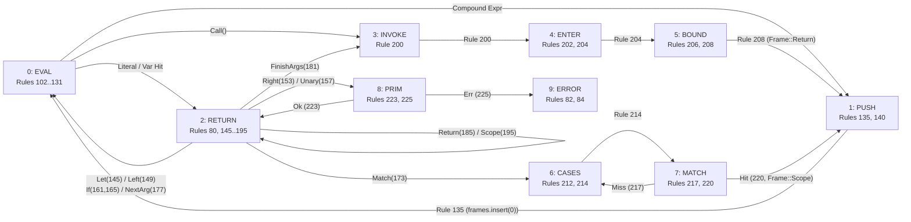

# Ring Study 03: Replacing the Passive Ruby Core with the 10-Sector Optical `Control` Stator & Live Readout Lens

## 1. Critique of the Legacy Passive Ruby Cabochon (`RefractiveRubyControlCore`)

In [`designer2_well.js`](file:///home/charles/sherlock-bench/src/designers/designer2_well.js#L1146-L1235) and [` update()`](file:///home/charles/sherlock-bench/src/designers/designer2_well.js#L1643-L1677), the center of the 6-ring horological well at `(x = 0, y = -0.30, z = 0)` is currently occupied by a static hemisphere dome (`rubyCabochonMesh`, `r = 0.14`, `scale.y = 0.48`, `IOR = 1.76`).

From both a **Sherlock CEK semantics** standpoint and a **Dieter Rams / Braun horological instrument** standpoint, the passive red Ruby sphere fails on four counts:

1. **Zero Discrimination Across the 10 `Control` Variants**:
   - In [`reference_types.rs`](file:///home/charles/repos/Moriarty/crates/mori-core/src/sherlock/reference_types.rs#L115-L126), `self.state.control: Option<Control>` is the **active execution head** (the $C$ register of the Sherlock CEK machine). Every single charged step in [`Machine::transition`](file:///home/charles/repos/Moriarty/crates/mori-core/src/sherlock/reference.rs#L102-L159) dispatches on one of **10 explicit `Control` variants**.
   - Yet in [`designer2_well.js`](file:///home/charles/sherlock-bench/src/designers/designer2_well.js#L1670-L1676), while `isDoneState` and `isErrorState` are false, the Ruby stays locked to a single unchanging color (`0x8a1c24`) across **all 36 charged rules**. Whether the machine is evaluating an AST node (`Control::Eval`), pushing a frame onto `frames[0]` (`Control::Push`), returning a value (`Control::Return`), looking up a function (`Control::Invoke`), binding parameters (`Control::Enter` / `Control::Bound`), scanning pattern arms (`Control::Cases` / `Control::CaseResult`), or committing an ALU primitive (`Control::PrimitiveResult`), the central Ruby looks identical.
2. **No Spatial Coupling Between `Control` and the 6 Horological Frame Rings**:
   - When `Control::Push` (`Rule 135`) pushes a `Frame` onto `frames[0]`, or when `Control::Return` (`Rules 145..195`) rewrites or pops `frames[0]`, the Ruby sits inertly at the center. Nothing visually connects the central `Control` register to the **West Half-Ring (`Slot A`)** or **East Half-Ring (`Slot B`)** of the active Horological Ring.
3. **No Live Symbolic Readout at the Focal Center**:
   - The user's eye naturally converges on the bullseye of the 6 concentric rings (`x = 0, z = 0`), but the Ruby displays no symbol, value, or expression headline (`fact(3)`, `4 × [?]`, `Return(6)`, `Done(24)`).
4. **Opaque Dome Occludes the Vertical Sightline into the Hollow 3D Chamber**:
   - A solid/semi-opaque red dome (`opacity: 0.96`, `r = 0.14`) blocks the central vertical sightline (`x = 0, z = 0`) looking down through the 6 concentric rings into the hollow stepped chamber (`y = -0.35..-2.15`) and the 39-rule decoder floor (`y = -2.18`).

---

## 2. Formal Mapping of the 10 `Control` Variants (`reference_types.rs` & `reference.rs`)

Inspecting [`Control`](file:///home/charles/repos/Moriarty/crates/mori-core/src/sherlock/reference_types.rs#L115-L126) and [`Machine::step` / `Machine::transition`](file:///home/charles/repos/Moriarty/crates/mori-core/src/sherlock/reference.rs#L45-L159), the central stator is partitioned into **10 equal $36^\circ$ radial sectors (`0..9`)**:

| Sector | Stator Code | Rust `Control` Variant (`reference_types.rs`) | Fired Rules (`reference.rs`) | Stack & Auxiliary Action | Sector Color (`PALETTE`) |
| :---: | :--- | :--- | :--- | :--- | :--- |
| **`0`** | **`EVAL`** | `Control::Eval(ExprRef)` | `102, 108, 111, 114, 117, 120, 123, 126, 129, 131` | Dispatches AST expression in `Machine::evaluate`; literals/vars transition to `Return`/`Error(3)` (`aux/1 EnvGetScan`), compound exprs schedule `Control::Push`. | `PALETTE.heat` (`#c84b31`) |
| **`1`** | **`PUSH`** | `Control::Push(Frame, Box<Control>, Environment)` | `135` (`PushFrame`), `140` (`FrameErr`) | Checks `frames.len() < stack_limit`. Inserts `frame` at `frames[0]` (`Rule 135`) and aims `controlPointer` at the newly occupied Half-Ring slot, or faults with `Error(4)` (`Rule 140`). | `PALETTE.amber` (`#d98a2b`) |
| **`2`** | **`RETURN`** | `Control::Return(Value)` | `80` (`Done`, 0F), `145, 149, 153, 157, 161, 165, 169, 173, 177, 181, 185, 190, 195` | If `frames.is_empty()`, publishes `Outcome::Done(value)` (`Rule 80`, charge `0`). Otherwise [`Machine::return_value`](file:///home/charles/repos/Moriarty/crates/mori-core/src/sherlock/reference.rs#L224-L294) inspects `frames[0]` to **REWRITE in place** (`Let→Scope` L145, `Left→Right` L149, `Args→Args` L177) or **POP** (`frames.remove(0)` on L153, L157, L161, L165, L173, L181, L185, L195). | `PALETTE.resolveBright` (`#45937a`) |
| **`3`** | **`INVOKE`** | `Control::Invoke(Name, Vec<Value>)` | `200` (`Lookup fn`) | Scans `Program.functions` (`aux/1 FindScan`) by `Name` and transitions to `Control::Enter(function, values)`. | `PALETTE.goldBright` (`#f2c66d`) |
| **`4`** | **`ENTER`** | `Control::Enter(Option<Function>, Vec<Value>)` | `202` (`Missing fn -> Error(7)`), `204` (`Bind params`) | Verifies function existence (`Rule 202` on `None`) and runs `bind(&function.parameters, &values)` (`aux/1 BindPreflight`, `Rule 204`). | `PALETTE.copper` (`#b87348`) |
| **`5`** | **`BOUND`** | `Control::Bound(Option<Environment>, Type, ExprRef)` | `206` (`Bind err -> Error(8)`), `208` (`Schedule body`) | Verifies parameter arity/type binding (`Rule 206` on `None`) or schedules `push(Frame::Return(ty, env), Control::Eval(body), callee_env)` (`Rule 208`). | `PALETTE.steelBright` (`#6794b5`) |
| **`6`** | **`CASES`** | `Control::Cases(Value, Vec<Arm>, Environment)` | `212` (`No match -> Error(9)`), `214` (`Try pattern`) | Tests scrutinee `Value` against `arms[0].pattern` via `matching(...)` (`Rule 214`), or raises `Error(9)` if `arms.is_empty()` (`Rule 212`). | `PALETTE.violet` (`#6e548a`) |
| **`7`** | **`MATCH`** | `Control::CaseResult(Option<Environment>, Value, ExprRef, Vec<Arm>, Environment)` | `217` (`Pattern miss`), `220` (`Match arm body`) | On `None`, retries remaining arms via `Control::Cases` (`Rule 217`). On `Some(bindings)`, schedules `push(Frame::Scope(env), Control::Eval(body), bindings)` (`Rule 220`). | `PALETTE.steel` (`#436278`) |
| **`8`** | **`PRIM`** | `Control::PrimitiveResult(Result<Value, u8>)` | `223` (`PrimOk`), `225` (`PrimErr`) | Receives checked `UInt128` / `Bool` / `List` / `Tree` result from `binary_result` / `unary_result` (`aux/2` ALU witness), transitioning to `Control::Return(value)` (`Rule 223`) or `Control::Error(code)` (`Rule 225`). | `PALETTE.gold` (`#d4a24c`) |
| **`9`** | **`ERROR`** | `Control::Error(u8)` *(plus zero-fuel trap)* | `82` (`Rejected(code)`, 0F), `84` (`Exhausted`, 0F) | Administrative zero-charge terminal publication in [`Machine::step`](file:///home/charles/repos/Moriarty/crates/mori-core/src/sherlock/reference.rs#L51-L60): publishes `Outcome::Rejected(code)` (`Rule 82`) or `Outcome::Exhausted` when `remaining_fuel == 0` (`Rule 84`). | `PALETTE.errorRed` (`#d63230`) |



---

## 3. 3D Horological Architecture of the Central `Control` Stator & Readout Ring (`x = 0, y = -0.30, z = 0`)

The innermost 6th Horological Depth Ring (`Ring 12`, `n = 5`) sits at `y = -0.28` with inner aperture radius `innerR = 0.418`. Suspended cleanly inside this `r = 0.418` aperture at `y = -0.30` (`CONTROL_CORE_Y = -0.30`) is the **3-part Optical `Control` Execution Head**:

```
Plan View at y = -0.30 (Inside Ring 12 Inner Aperture r = 0.418):

                     North (-Z: ProgramBlock / Call Arc)
                                  │
                         ┌────────┴────────┐
                    9:ERR│  0:EVAL  1:PUSH │2:RET
                  ───────┼─────────────────┼───────
       West (-X)  8:PRIM │  [ Open Lens ]  │3:INV   East (+X)
     (Slot A: 2n) ───────│   r = 0.00..0.13│──────► (Slot B: 2n+1)
                  7:MTCH │   "4 × [ ? ]"   │4:ENT   controlPointer
                         └────────┬────────┘
                    6:CASE  5:BND │
                                  │
                     South (+Z: Aux/1 & Aux/2 Witnesses)
```

### 3.1 Component A: 10-Sector Optical `Control` Stator Bezel (`r = 0.14..0.21`)

- **Geometry & WebGPU Instancing**:
  - A precision-machined titanium foundation collet ring (`r = 0.135..0.215`, height `0.012`, `PALETTE.graphiteDark`) suspended by 4 ultra-thin Tension Hairlines (`r = 0.0018`, spanning `r = 0.215..0.418` at `45°, 135°, 225°, 315°` so Cardinal axes `N/S/E/W` remain clear for the pointer).
  - Above the collet sit **10 radial sector keys** (`rInner = 0.14`, `rOuter = 0.21`, angular span `32°` with a `4°` dark anodized isolation kerf between sectors).
  - **Single `THREE.InstancedMesh` (`count = 10`)**:
    - Base geometry: a single low-poly chamfered sector block (`BoxGeometry(0.036, 0.010, 0.068)` or extruded `32°` arc segment centered at `rMid = 0.175`).
    - Sector `k` (`0..9`) is positioned at angle $\theta_k = -\frac{\pi}{2} + k \cdot \frac{2\pi}{10}$, placing `0: EVAL` at top-dead-center (`12 o'clock`, `-Z`), `1: PUSH` at `36°`, `2: RETURN` at `72°`, `3: INVOKE` at `108°`, `4: ENTER` at `144°`, `5: BOUND` at `180°` (`6 o'clock`), `6: CASES` at `216°`, `7: MATCH` at `252°`, `8: PRIM` at `288°`, and `9: ERROR` at `324°`.
  - **Static Engraved Stator Legend Overlay (`1` draw call)**:
    - A single `512×512` `CanvasTexture` mapped onto a `RingGeometry(0.138, 0.212, 60)` (`depthWrite: false`) crisp-engraves the 10 radial sector codes (`0:EVAL`, `1:PUSH`, `2:RET`, `3:INV`, `4:ENT`, `5:BND`, `6:CASE`, `7:MTCH`, `8:PRIM`, `9:ERR`) and micro-tick graduations once at initialization.
- **Dynamic Step Behavior**:
  - On every frame in `.update(stepState)`, the active `Control` variant (`step.controlKind` before transition and `step.after.control.kind` after transition, interpolated by `stepFraction`) selects active sector `activeSectorIdx ∈ [0..9]`.
  - **Active Sector Elevation & Illumination**: The active sector elevates by `+0.006` along `+Y`, scales radially by `1.06`, and illuminates with its semantic `PALETTE` color (`setColorAt(k, _scratchColor)`), while the previous step's sector retains a decaying `0.35` afterglow trail so the user can visually read the two-state transition (e.g. `1:PUSH -> 0:EVAL` on Rule 135, or `2:RETURN -> 8:PRIM` on Rule 153).
  - Inactive sectors rest flush at `y = 0.004` in calm dark gunmetal (`0x22242a`).

### 3.2 Component B: Rotating Radial Transfer Pointer (`controlPointer`, `r = 0.135..0.385`)

The `controlPointer` is a precision-machined counter-balanced watchmaker's index hand (`1` mesh / group with a slim tapered needle extending from the stator collar `r = 0.135` out to `r = 0.385`, just inside Ring 12's `innerR = 0.418`) that physically couples the central `Control` register to the active **Half-Ring Arc** during stack transitions:

1. **Half-Ring Slot Addressing (`Slot A` = West vs `Slot B` = East)**:
   - Each of the 6 Concentric Horological Depth Rings (`n = 0..5`) holds **2 frame slots**:
     - **Slot A (Even frame index `2n`, West Half-Ring Arc, $\theta \approx \pi$)**: `frames` depth where `(frameCount - 1) % 2 === 0`.
     - **Slot B (Odd frame index `2n + 1`, East Half-Ring Arc, $\theta \approx 0$)**: `frames` depth where `(frameCount - 1) % 2 === 1`.
2. **Azimuthal & Pitch Choreography by Transition Kind**:
   - **`PUSH` Transition (`Control::Push`, Rule `135`, or rules scheduling `Push` `114..131, 208, 220`)**:
     - Determines the target slot index `slotIdx = step.after.frames.length - 1` (or `step.before.frameCount`).
     - Aims `controlPointer` directly at **West ($\theta = \pi - 0.18 \cdot n$)** if `slotIdx % 2 === 0` (`Slot A`), or **East ($\theta = 0 + 0.18 \cdot n$)** if `slotIdx % 2 === 1` (`Slot B`), and pitches its tip upward toward the elevation `ringY` of ring `n = clamp(Math.floor(slotIdx / 2), 0, 5)`.
     - Color: Warm Amber-Gold (`PALETTE.amber` / `PALETTE.heatBright`) for pending operand pushes, or Emerald-Teal (`PALETTE.resolveBright`) when `Bound` (`Rule 208`) pushes `Frame::Return` or `Match` (`Rule 220`) pushes `Frame::Scope`.
   - **`REWRITE` Transition (`Control::Return` rewriting `frames[0]` in place: Rules `145 Let→Scope`, `149 Left→Right`, `177 Args→Args`)**:
     - `step.before.frameCount === step.after.frames.length` while `step.controlKind === 'Return'`.
     - `controlPointer` locks onto the active top-of-stack Half-Ring Arc (`West` for even `topSlot`, `East` for odd `topSlot`) and pulses Bright Copper-Gold (`PALETTE.goldBright`), signaling an in-place frame mutation without changing stack depth.
   - **`POP` Transition (`Control::Return` popping `frames[0]`: Rules `153, 157, 161, 165, 173, 181, 185, 195`)**:
     - `step.after.frames.length < step.before.frameCount`.
     - `controlPointer` sweeps from the popped Half-Ring Arc (`West` or `East`) inward toward the active `Control` stator sector (`8:PRIM` on `153/157`, `0:EVAL` on `161/165`, `6:CASES` on `173`, `3:INVOKE` on `181`, or `2:RETURN` on `185/195`), colored in Lit Emerald (`PALETTE.resolveBright`).
   - **`EVAL` / `INVOKE` / `ENTER` / `PRIM` / `CASES` (Pure Control Transitions)**:
     - Aims radially at the active stator sector angle $\theta_k$ so the pointer doubles as a crisp coaxial sector hand when no frame slot is being mutated.

### 3.3 Component C: Open Sapphire Readout Lens (`r = 0.00..0.13`)

Instead of an opaque red hemisphere that blocks the center of the well, the inner aperture (`r = 0.00..0.13`) houses an **Open Sapphire Readout Lens**:

1. **Unobstructed Vertical Sightline into the Hollow 3D Chamber**:
   - The lens body is an ultra-thin flat optical ring/reticle (`RingGeometry(0.088, 0.132, 48)` + a `PlaneGeometry(0.24, 0.24)` HUD decal with `transparent: true, depthWrite: false`) whose central core (`r < 0.088`) is **completely transparent (`alpha = 0`)** except for crisp high-contrast vector typography.
   - When the camera orbits above or dives down the well shaft (`x = 0, z = 0`), it sees straight through the Sapphire Readout Lens to the suspended `Frame` wafers in the hollow chamber (`y = -0.35..-2.15`) and the illuminated 39-rule floor (`y = -2.18`).
2. **Live Symbolic Headline & Sub-Readout (LRU Cached `CanvasTexture`)**:
   - Displays a two-line high-contrast horological reticle readout at `y = -0.296`:
     - **Top Arc / Badge**: Active Stator Code & Rule ID (e.g. `EVAL · A117`, `PUSH · A135`, `RET · A149`, `PRIM · A223`, `DONE · A080`).
     - **Center Headline (14 chars max, bold monospace)**:
       - During binary/unary/let evaluation: algebraic focus atom or waiting hole, e.g. `4 × [ ? ]`, `3 - 1`, `n == 0`.
       - During function call lifecycle (`Invoke` / `Enter` / `Bound`): `fact(3)`, `is_odd(2)`.
       - During value return / primitive commit (`Return` / `PrimitiveResult`): `Return(6)`, `PrimOk(24)`.
       - During terminal publication: `Done(24)` (emerald), `Err(10)` or `Exhausted` (crimson).
   - **Zero Per-Frame Texture Allocation**:
     - Uses a dedicated module-scope string-keyed LRU cache (`controlLensTextureCache`, bounded at `256` entries) and updates `lensDecalMat.map` **only when `stepIndex` or `headlineKey` changes** (`if (lensKey !== lastLensKey)`), guaranteeing **0 DOM `<canvas>` creations and 0 GPU texture uploads** during 60fps playback and scrubbing.
3. **Terminal `outputWave` Ring (`r = 0.15..0.175`)**:
   - Preserves the single clean expanding `outputWave` ring on `Outcome::Done` (`Rule 80`), radiating outward from the stator perimeter across the 6 horological rings.

---

## 4. WebGPU (`three/webgpu`) Performance & Zero-Allocation Contract

To maintain a locked 60fps frame budget under `WebGPURenderer`:

| Sub-Element | Geometry / Material | Draw Calls | Per-Frame `.update(stepState)` Cost |
| :--- | :--- | :---: | :--- |
| **Stator Foundation Collet & 4 Tension Hairlines** | Merged or static `TorusGeometry` + `CylinderGeometry` (`MeshStandardMaterial`) | `2` | `0` (static) |
| **10-Sector Optical Stator (`statorInstancedMesh`)** | `THREE.InstancedMesh(sectorGeo, sectorMat, 10)` | `1` | `10` iterations updating `setMatrixAt` + `setColorAt` using pre-allocated `_scratchPos`, `_scratchQuat`, `_scratchScale`, `_scratchMat4`, `_scratchColor` |
| **Static 10-Sector Engraved Dial Ring** | `RingGeometry(0.138, 0.212, 60)` + static `512×512` `CanvasTexture` | `1` | `0` (static) |
| **Rotating Radial Transfer Pointer (`controlPointer`)** | Tapered pointer `Group` (`pointerShaftMesh` + `pointerTipMesh`) | `2` | Spring-damped azimuth `pointerAngle` & pitch `pointerPitch` scalar math (`0` heap allocations) |
| **Open Sapphire Readout Lens (`sapphireLensMesh`)** | `PlaneGeometry(0.25, 0.25)` (`depthWrite: false`) + LRU-cached `CanvasTexture` | `1` | Texture swap only when `stepIndex` changes (`0` per-frame canvas allocations) |
| **Terminal `outputWave` Ring** | `RingGeometry(0.15, 0.175, 64)` (`MeshBasicMaterial`) | `1` (when visible) | Scalar scale & opacity update |

### Module-Scope Zero-Allocation Classifier Helper

```js
// Ordered 10-variant stator table matching reference_types.rs `pub enum Control`
export const CONTROL_STATOR_SECTORS = [
  { index: 0, kind: 'Eval',            code: 'EVAL',   rules: '102..131', color: PALETTE.heat,          css: CSS_COLORS.heat },
  { index: 1, kind: 'Push',            code: 'PUSH',   rules: '135, 140', color: PALETTE.amber,         css: CSS_COLORS.amber },
  { index: 2, kind: 'Return',          code: 'RETURN', rules: '80, 145+', color: PALETTE.resolveBright, css: CSS_COLORS.resolveBright },
  { index: 3, kind: 'Invoke',          code: 'INVOKE', rules: '200',      color: PALETTE.goldBright,    css: CSS_COLORS.goldBright },
  { index: 4, kind: 'Enter',           code: 'ENTER',  rules: '202, 204', color: PALETTE.copper,        css: '#b87348' },
  { index: 5, kind: 'Bound',           code: 'BOUND',  rules: '206, 208', color: PALETTE.steelBright,   css: CSS_COLORS.steelBright },
  { index: 6, kind: 'Cases',           code: 'CASES',  rules: '212, 214', color: PALETTE.violet,        css: CSS_COLORS.violet },
  { index: 7, kind: 'CaseResult',      code: 'MATCH',  rules: '217, 220', color: PALETTE.steel,         css: CSS_COLORS.steel },
  { index: 8, kind: 'PrimitiveResult', code: 'PRIM',   rules: '223, 225', color: PALETTE.gold,          css: CSS_COLORS.gold },
  { index: 9, kind: 'Error',           code: 'ERROR',  rules: '82, 84',   color: PALETTE.errorRed,      css: CSS_COLORS.errorRed },
];

export function getControlSectorIndex(controlKind, ruleLine) {
  if (ruleLine === 82 || ruleLine === 84 || controlKind === 'Error') return 9;
  if (ruleLine === 80) return 2;
  switch (controlKind) {
    case 'Eval':            return 0;
    case 'Push':            return 1;
    case 'Return':          return 2;
    case 'Invoke':          return 3;
    case 'Enter':           return 4;
    case 'Bound':           return 5;
    case 'Cases':           return 6;
    case 'CaseResult':      return 7;
    case 'PrimitiveResult': return 8;
    default:                return 0;
  }
}
```
