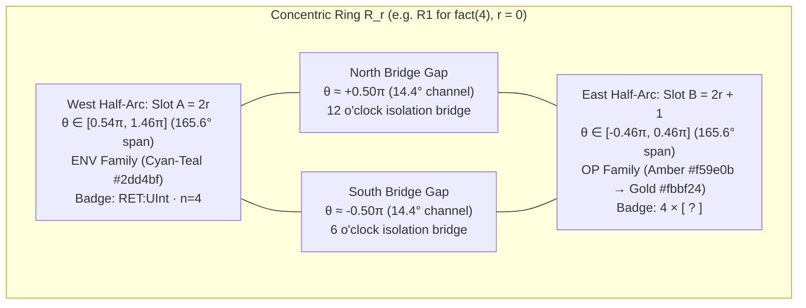
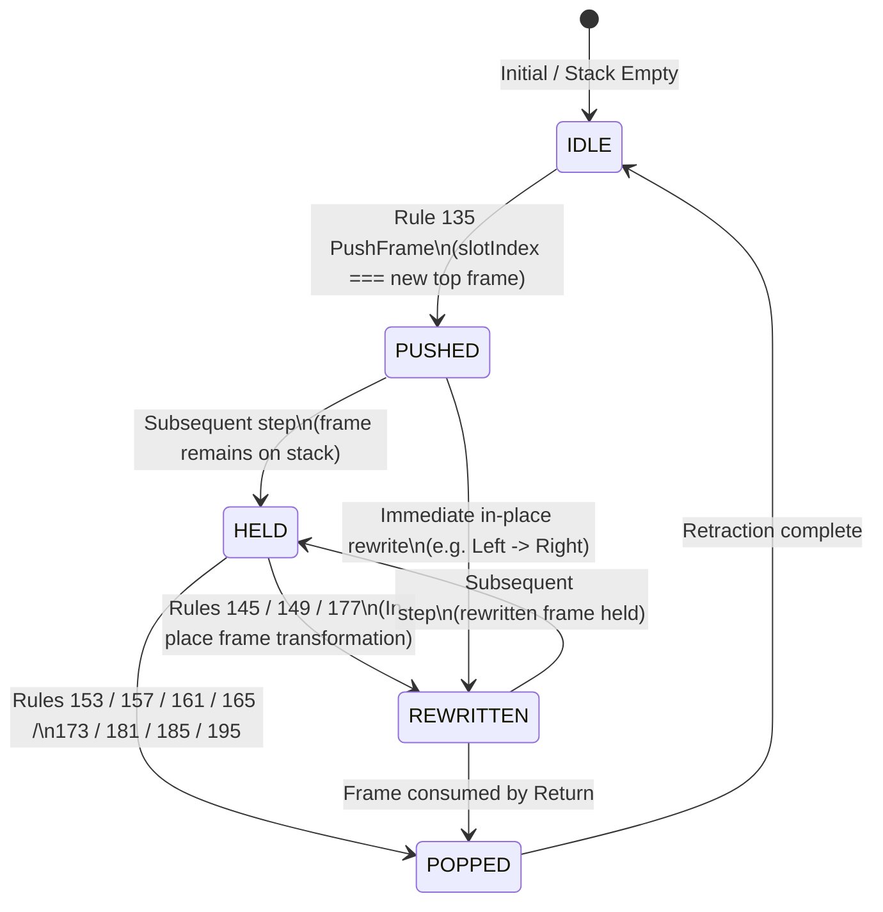

# Ring Study 04: Split-Arc Horological & Semiconductor Ring Geometry (`R1`..`R6`)

## 1. Horological & Micro-Machining Research Synthesis

Using `search_web` and `scrapling` (`Fetcher`), we investigated three foundational references in modern mechanical horology and precision semiconductor micro-machining to ground the geometry of the **6 Concentric Split-Arc Rings (`R1`..`R6`)**:

1. **Ressence Orbital Convex System (ROCS) — Benoît Mintiens**:
   - Ressence replaces traditional overlapping watch hands with **co-planar and stepped orbital Grade 5 Titanium (`Ti-6Al-4V`) discs and rings** separated by precision micro-toleranced air gaps.
   - Each ring acts simultaneously as a **structural mechanical carrier** and a **high-contrast graphic information surface**: flush-engraved typographic indices sit directly on the moving titanium surface so mechanical rotation/elevation and semantic state read as a single unified surface.
2. **A. Lange & Söhne Zeitwerk — *Zeitbrücke* (Time Bridge) & Jumping Disc Escapement**:
   - The Zeitwerk frames its mechanical digital jumping rings beneath a structural **rhodium-plated German silver bridge (*Zeitbrücke*)** featuring hand-polished **45° diamond-cut chamfers (*anglage*)** that catch grazing light in razor-sharp specular lines against a linearly brushed satin deck.
   - Driven by a constant-force escapement (*remontoire*) and fly governor, the numeral rings perform **crisp, high-torque micro-indexing jumps** rather than sluggish continuous drift—an ideal physical metaphor for discrete CEK abstract machine transitions (`Push`, `Right operand` in-place rewrite, and `Return` pop).
3. **High-Contrast Anodized Titanium & Galvanic Rhodium Chamfering**:
   - Pairing **satin gunmetal-rhodium idle arcs** (`roughness: 0.34, metalness: 0.88`) recessed inside a **deep gunmetal-sapphire optical well (`0x161d29`)** against **mirror-polished 45° inner bevels** and **electrochemical / micro-LED inner light-channels** produces unmistakable figure-ground separation between **Idle (`occupied: false`)** and **Occupied (`occupied: true`)** frame slots.

---

## 2. Why Each of the 6 Rings (`R1`..`R6`) Is Divided into Two Independent 180° Half-Ring Arcs

In the Sherlock CEK machine (`sherlock-k-a/1`), the continuation stack `frames: Vec<Frame>` holds up to **12 active continuation frames** across the 6 concentric horological depth rings (`2 frames per ring × 6 rings = 12 frame slots`).

When rendered as continuous 360° solid rings, a viewer cannot visually distinguish whether a ring holds **1 frame** (`fill = 0.5`) or **2 frames** (`fill = 1.0`), nor can a single ring display two distinct `Frame` families simultaneously. In recursive programs like `factorial(4)`, every recursive activation of `fact(n)` pushes **an exact pair of heterogeneous frames** onto the continuation stack:

1. **First Frame of the Call Pair (`Slot A = 2r`, West Half-Arc)**:
   - When `fact(n)` is entered at **Rule 208 (`Schedule body`)**, the machine pushes `Frame::Return(returnType: UInt, caller_env)` to verify the return type contract and restore the caller's lexical environment (`n`) upon completion.
   - This frame belongs to the **`ENV` Family (Cyan-Teal `0x2dd4bf`)**.
2. **Second Frame of the Call Pair (`Slot B = 2r + 1`, East Half-Arc)**:
   - Inside the `else` branch `n * fact(n - 1)`, **Rule 117 (`Binary left`)** pushes `Frame::Left([?] * fact(n - 1))` into the second slot of that same ring. Immediately after `n` evaluates, **Rule 149 (`Right operand`)** rewrites that exact slot **in-place** into `Frame::Right(n * [?])` while the recursive call `fact(n - 1)` descends into the next inner ring `R_{r+1}`!
   - This frame belongs to the **`OP` Family (Amber `0xf59e0b` $\rightarrow$ Luminous Gold `0xfbbf24`)**.

By bisecting every ring `R1`..`R6` along the North–South meridian into **Two Independent Architectural Half-Ring Arcs (`Slot A` West and `Slot B` East)** separated by **North & South Precision Bridge Gaps**, the 3D geometry becomes a 1-to-1 physical isomorphism of recursive evaluation:

### 2.1 Angular Partitioning of Each Concentric Ring (`R1`..`R6`)

In the Three.js XZ horizontal plane (where $\theta = \text{atan2}(z, x)$, with $\theta = 0$ at **East / 3 o'clock**, $\theta = +0.50\pi$ at **South / 6 o'clock**, $\theta = \pi$ at **West / 9 o'clock**, and $\theta = -0.50\pi$ at **North / 12 o'clock**):

| Architectural Element | Slot Formula | Angular Domain $\theta$ (Radians) | Angular Span (Degrees) | Primary Semantic Role in `factorial(4)` |
| :--- | :--- | :--- | :--- | :--- |
| **West Half-Arc (`Slot A`)** | `slotIndex = 2 * r` | $\theta \in [0.54\pi,\; 1.46\pi]$ | $0.92\pi\;\text{rad} = 165.6^\circ$ | Holds 1st frame of ring pair: `Frame::Return(: UInt, caller_env)` (`ENV` Cyan-Teal `0x2dd4bf`) |
| **East Half-Arc (`Slot B`)** | `slotIndex = 2 * r + 1` | $\theta \in [-0.46\pi,\; +0.46\pi]$ | $0.92\pi\;\text{rad} = 165.6^\circ$ | Holds 2nd frame of ring pair: `Frame::Left` $\rightarrow$ `Frame::Right(n * [?])` (`OP` Amber $\rightarrow$ Gold `0xfbbf24`) |
| **North Precision Bridge Gap** | 12 o'clock separator | $\theta \in [-0.54\pi,\; -0.46\pi]$ centered at $-0.50\pi$ | $0.08\pi\;\text{rad} = 14.4^\circ \approx 14^\circ$ | Crisp 14° architectural separation channel isolating `Slot A` (West) from `Slot B` (East) |
| **South Precision Bridge Gap** | 6 o'clock separator | $\theta \in [+0.46\pi,\; +0.54\pi]$ centered at $+0.50\pi$ | $0.08\pi\;\text{rad} = 14.4^\circ \approx 14^\circ$ | Crisp 14° architectural separation channel completing the 12-slot radial sightline |

---

## 3. Exact Radial & Vertical Stepping Specification (`R1` Outer to `R6` Inner)

The 6 concentric split-arc rings step inward and downward from the outer aperture bezel (`R1`, `r ≈ 0.94`, `baseY = 0.060`) toward the central 10-sector `Control` stator (`R6`, `r ≈ 0.30`, `baseY = -0.280`). Chronological bottom-of-stack indexing (`chronoFrames = [...frames].reverse()`) ensures that once a frame is pushed into a half-arc slot, **it remains anchored in that exact physical half-ring arc until it is popped**, preserving spatial permanence:

| Ring ID | Ring Index `r` | Chronological Frame Slots | Outer Radius `outerR` | Mid Radius `midR` | Inner Radius `innerR` | Base Elevation `baseY` | Idle Elevation (`baseY - 0.015`) | Occupied Elevation (`baseY + 0.012`) | Peak `fact(4)` State (`8/12` Slots Occupied) |
| :--- | :---: | :---: | :---: | :---: | :---: | :---: | :---: | :---: | :--- |
| **`R1`** | `0` | `Slot 0` (W) · `Slot 1` (E) | `0.980` | `0.940` | `0.900` | `+0.060` | `+0.045` | `+0.072` | **W:** `RET:UInt · entry` (`ENV`) **E:** `4 × [ ? ]` (`OP` Gold) |
| **`R2`** | `1` | `Slot 2` (W) · `Slot 3` (E) | `0.852` | `0.812` | `0.772` | `-0.008` | `-0.023` | `+0.004` | **W:** `RET:UInt · n=4` (`ENV`) **E:** `3 × [ ? ]` (`OP` Gold) |
| **`R3`** | `2` | `Slot 4` (W) · `Slot 5` (E) | `0.724` | `0.684` | `0.644` | `-0.076` | `-0.091` | `-0.064` | **W:** `RET:UInt · n=3` (`ENV`) **E:** `2 × [ ? ]` (`OP` Gold) |
| **`R4`** | `3` | `Slot 6` (W) · `Slot 7` (E) | `0.596` | `0.556` | `0.516` | `-0.144` | `-0.159` | `-0.132` | **W:** `RET:UInt · n=2` (`ENV`) **E:** `1 × [ ? ]` (`OP` Gold) |
| **`R5`** | `4` | `Slot 8` (W) · `Slot 9` (E) | `0.468` | `0.428` | `0.388` | `-0.212` | `-0.227` | `-0.200` | **W:** `RET:UInt · n=1` (`ENV`, base case) **E:** Transient `0 == 0` (`OP`) $\rightarrow$ Idle |
| **`R6`** | `5` | `Slot 10` (W) · `Slot 11` (E) | `0.340` | `0.300` | `0.260` | `-0.280` | `-0.295` | `-0.268` | Deep recursion reserve (`Slots 10–11`) surrounding central `Control` core |

### 3.1 Cross-Sectional Chamfer Profile (*Anglage*) of Each Half-Ring Arc

Each 165.6° Half-Ring Arc is lathe-turned (`THREE.LatheGeometry(latheProfile, 48, phiStart, phiLength)`) with a 6-vertex horological cross-section:
- **Radial Width**: `w = outerR - innerR = 0.080` world units, leaving a crisp `0.048` radial air-gap step between adjacent concentric rings so the downward stair-stepping (`ΔbaseY = -0.068` per ring) casts sharp shadow lines under the 5-point macro studio lighting rig.
- **Vertical Thickness**: `ringThickness = 0.052` world units, with **45° top-outer and top-inner diamond-cut chamfers** (`ringBevel = 0.011`).
- **Beveled Inner Light-Channel**: Inset along the inner rim (`r ∈ [innerR + 0.008, innerR + 0.026]`, `y = +0.0018` above the arc deck) sits a continuous 165.6° optical light-channel that reflects off the 45° inner chamfer and illuminates the central recursion well.
- **North & South Bridge Gap Architecture (`θ = ±0.50π`)**: Within the two 14.4° separation channels at 12 o'clock and 6 o'clock, a recessed matte gunmetal-sapphire bridge spine (`0x161d29`) visually anchors the concentric well while exposing the clean radial break between `Slot A` (West) and `Slot B` (East).

---

## 4. Physical & Chromatic Response to Sherlock CEK Transitions

Each of the 12 Half-Ring Arcs (`slotIndex ∈ 0..11`) is an independent mechanical actuator driven by the per-slot transition state (`IDLE`, `PUSHED`, `HELD`, `REWRITTEN`, `POPPED`) computed between `step.before.frames` and `step.after.frames`:

### 4.1 Idle State (`occupied: false`)
- **Physical Elevation**: Recessed smoothly to **`y = baseY - 0.015`** (`15 mil` below nominal ring plane), sitting quietly inside the stepped well shadow so unoccupied inner rings (`R5`, `R6` during shallow calls) never visually compete with active outer rings.
- **Surface & Channel Finish**:
  - **Arc Body**: Satin gunmetal-rhodium (`0x383c46` / `0x42403d`, `roughness: 0.34`, `metalness: 0.88`), catching only subtle cool-sky fill reflections.
  - **Beveled Inner Light-Channel**: Muted dark gunmetal-slate (`color: 0x1c2331`, `emissive: 0x161d29`, `emissiveIntensity: 0.02`).
  - **Jewel Latches (3 per Half-Arc)**: Dark unlit hematite (`0x2c303a`).
  - **Slot Badge Plaque**: Hidden or recessed low-opacity index engraving (`opacity: 0.22`) showing only the passive slot numeral (`01`..`12`).

### 4.2 Occupied State (`occupied: true`, `transition === 'PUSHED' | 'HELD'`)
- **Physical Elevation**: Elevates smoothly via damped spring interpolation to **`y = baseY + 0.012`** (a crisp **`+0.027` world-unit mechanical lift** above the idle state). On the initial `PUSHED` step (Rule 135 `PushFrame`), the arc performs a subtle `+0.004` proud engagement overshoot before settling at `baseY + 0.012`.
- **Beveled Inner Light-Channel Illumination**: Ignites with the active `Frame` variant's semantic family color (`emissiveIntensity: 0.95` on active top-of-stack slot, `0.68` on held parent slots):
  - **`ENV` Family (`Return`, `Scope`)**: Luminous Cyan-Teal (`0x2dd4bf` for `Return`, `0x38bdf8` for `Scope`).
  - **`OP` Family (`Left`, `Right`, `Unary`, `Args`)**: Warm Amber (`0xf59e0b` for `Left`), Luminous Gold (`0xfbbf24` for `Right`), Copper-Amber (`0xf97316` / `0xfb923c` for `Unary` / `Args`).
  - **`GATE` Family (`If`, `Match`, `Let`)**: Royal Violet-Indigo (`0x818cf8` for `If`, `0xa78bfa` for `Match`, `0xc084fc` for `Let`).
- **Crisp Engraved Slot Badge (`Slot A` West vs. `Slot B` East)**:
  - Each occupied half-arc displays a flush, curved high-DPI slot badge (`createPlaqueTexture`, LRU-cached) centered at $\theta_{\text{West}} = \pi$ (`9 o'clock`) for `Slot A` and $\theta_{\text{East}} = 0$ (`3 o'clock`) for `Slot B`:
    - **West Half-Arc (`Slot A`) Example**: `[RET] RET:UInt · n=4` (showing the return type contract and saved caller binding).
    - **East Half-Arc (`Slot B`) Example**: `[RGT] 4 × [ ? ]` (showing the locked left operand `4`, operator `×`, and waiting hole `[ ? ]`).

### 4.3 In-Place Rewrite State (`transition === 'REWRITTEN'`, Rules 145 / 149 / 177)

A defining feature of the Sherlock CEK machine is that three high-frequency continuation rules **mutate the top frame in-place at the exact same stack depth (`slotIndex`) without pushing or popping**:

| Rule ID & Line | Transition Name | Before Frame (`step.before`) | After Frame (`step.after`) | Chromatic Shift on Half-Ring Arc | Physical Micro-Indexing Kinematics |
| :--- | :--- | :--- | :--- | :--- | :--- |
| **`A149` (Line 149)** | `Right operand` | `Frame::Left([?] * fact(n-1))` | `Frame::Right(4 * [?])` | **Warm Amber (`0xf59e0b`) $\rightarrow$ Luminous Gold (`0xfbbf24`)** (`OP` family lock-in) | Crisp $\Delta\theta = \pm 0.038\;\text{rad}$ (`2.2°`) rotational escapement pulse + `+0.005` vertical detent click |
| **`A145` (Line 145)** | `Bind let` | `Frame::Let(let sq = [?])` | `Frame::Scope(restore scope)` | **Violet-Indigo (`0xc084fc`, `GATE`) $\rightarrow$ Sky Cyan-Teal (`0x38bdf8`, `ENV`)** | Crisp $\Delta\theta = \pm 0.038\;\text{rad}$ rotational escapement pulse as binding commits into lexical scope |
| **`A177` (Line 177)** | `Next arg` | `Frame::Args(fn(1/2 args))` | `Frame::Args(fn(2/2 args))` | **Copper-Amber (`0xfb923c`) $\rightarrow$ Bright Gold-Amber (`0xfbbf24`)**ratchet pulse | Crisp $\Delta\theta = \pm 0.032\;\text{rad}$ multi-arg accumulator ratchet step |

When `transition === 'REWRITTEN'` fires on a Half-Ring Arc:
1. **Horological Micro-Indexing Rotation Pulse**: Inspired by the A. Lange & Söhne Zeitwerk remontoire jump, an angular impulse `spinVel += direction * 0.85` is injected into that specific half-arc's spring damper (`spinTarget`), producing a crisp, tactile rotational indexing click ($\approx 2.2^\circ$ peak deflection that snaps cleanly back into alignment against the North/South bridge stops).
2. **Vertical Detent Pulse**: The half-arc briefly lifts an additional `+0.005` above its occupied height (`y = baseY + 0.017` peak $\rightarrow$ `baseY + 0.012`) as the new frame state latches.
3. **Channel & Latch Color Shift**: The beveled inner light-channel and the 3 hemisphere jewel latches on that half-arc smoothly cross-fade across `stepFraction` from the pre-rewrite color (e.g., Amber `0xf59e0b` for `Left`) to the post-rewrite color (e.g., Luminous Gold `0xfbbf24` for `Right` with a `1.45×` emissive flare at `stepFraction ≈ 0.35`), while the engraved slot badge updates in-place from `[LFT] [ ? ] × fact(n-1)` to `[RGT] 4 × [ ? ]`.

### 4.4 Popped / Unwind Release (`transition === 'POPPED'`)
- When a frame is consumed (`Rule 153 Binary primitive`, `Rule 185 Return type ok`, `Rule 195 Restore scope`, `Rule 161/165 If branch`), its Half-Ring Arc flashes briefly with resolve luminance, releases its 3 jewel latches back to dark hematite (`0x2c303a`), and retracts smoothly down to the recessed idle seat (`y = baseY - 0.015`).

---

## 5. WebGPU (`three/webgpu`) Performance & Batching Architecture

To guarantee zero frame drops and minimal draw calls in `designer2_well.js`:
1. **Exact Partial-Arc Geometry (Zero Wasted Gap Polygons)**:
   - Each West Half-Arc (`Slot A = 2r`) and East Half-Arc (`Slot B = 2r + 1`) is generated directly over its $0.92\pi$ angular domain (`LatheGeometry(latheProfile, 48, phiStart, 0.92 * Math.PI)` and `RingGeometry(innerR, outerR, 48, 1, thetaStart, 0.92 * Math.PI)`), leaving the two $14.4^\circ$ North/South bridge gaps completely open in geometry rather than relying on fragment alpha-clipping.
2. **Single `THREE.InstancedMesh` for All 36 Jewel Latches (3 Latches × 12 Half-Arcs)**:
   - All 36 hemisphere jewel latches (`3 latches per half-arc × 12 half-arcs`) are batched into a single `THREE.InstancedMesh` with `DynamicDrawUsage`.
   - Latches `k ∈ [0, 1, 2]` sit on **West Half-Arc (`Slot A = 2r`)** and transform with `arcA.y` and `arcA.spin`; latches `k ∈ [3, 4, 5]` sit on **East Half-Arc (`Slot B = 2r + 1`)** and transform with `arcB.y` and `arcB.spin`.
3. **Zero Heap Allocations in `.update(stepState)`**:
   - All matrix compositions, color interpolations, and spring-physics updates for the 12 Half-Ring Arcs use pre-allocated module-scope scratch primitives (`_scratchMat4`, `_scratchPos`, `_scratchQuat`, `_scratchEuler`, `_scratchScale`, `_scratchColor`, `_scratchColorB`).
   - Slot badge textures on the 12 half-arcs are retrieved from the string-keyed LRU cache (`createPlaqueTexture`) and only reassigned when the slot's state signature (`kind|label|binding`) changes.
