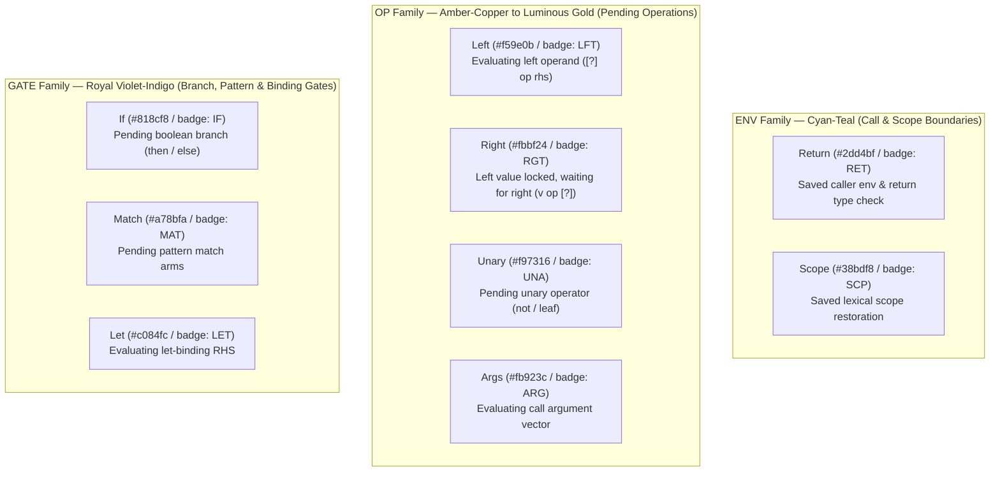

# Ring Study 05: Chip Materiality, Color Palette & Surface Texture Architecture

## 1. Executive Summary: From Muddy Dark-Brown to High-Contrast Horological Precision

Earlier iterations of the Sherlock CEK 3D chip relied on a dark, low-contrast brown/charcoal palette (`ceramic: 0x252422`, `titanium: 0x5c5b57`, `substrateRim: 0x34322f`). Under studio lighting, the package body, top deck, and central well blended into a single dark mass, diminishing the legibility of the concentric horological rings, active pads, and saved continuation frames.

Drawing directly from **Braun/Rams industrial instrumentation**, **Apple Silver-Platinum unibody machining**, and **high-complication German/Swiss horology (A. Lange & Söhne / Ressence)**, this study establishes a three-tier architectural contrast hierarchy:

1. **Package Ceramic Body — Warm Alabaster Porcelain Ceramic (`0xebe5da`)**:
   - The outer IC carrier body is molded from micro-pebbled **Warm Alabaster / Porcelain Ceramic** (`PALETTE.ceramicAlabaster = 0xebe5da`, edge bevels `PALETTE.ceramicEdge = 0xd5cec0`) accented by precision **Champagne-Gold (`0xd4af37`)** bevel chamfers and perimeter contacts.
   - Textured via the singleton procedural `createCeramicGrainTexture()`, which renders a fine isotropic mineral micro-pebble grain on a 256×256 repeating canvas without per-frame allocations.

2. **Unibody Top Deck — Fine Brushed Silver-Platinum Anodized Titanium (`0xd8dde6`)**:
   - The precision-machined top deck (`PALETTE.titanium = 0xd8dde6`, highlight `PALETTE.titaniumSilver = 0xe2e7f0`) uses `metalness: 0.78, roughness: 0.24` paired with `createBrushedMetalTexture()`.
   - Linear anisotropic brush streaks catch the 4-light WebGPU studio rig (`SherlockStage.js`), creating crisp specular roll-off around the stepped bezel and pad array while keeping engraved rule plaques legible.

3. **Hollow Well & Ring Channel Base — Deep Anodized Gunmetal-Sapphire Slate (`0x18202c` / `0x161d29`)**:
   - The recessed continuation well (`PALETTE.wellSlate = 0x161d29`, `PALETTE.graphite = 0x1c2331`) drops into a deep, matte gunmetal-sapphire cavity (`roughness: 0.72, metalness: 0.35`).
   - This dark optical chamber acts as a high-contrast stage so the illuminated **Cyan-Teal (`ENV`)**, **Amber-Gold (`OP`)**, and **Violet-Indigo (`GATE`)** split-ring arcs and central **Ruby-Ember `Control` Core** pop with zero visual ambiguity.

---

## 2. Three-Tier Material & Surface Specification

| Architectural Zone | Material Name | Hex / Token | PBR Parameters | Procedural Texture |
| :--- | :--- | :--- | :--- | :--- |
| **Package Carrier Body** | Warm Alabaster Porcelain Ceramic | `0xebe5da` (`PALETTE.ceramicAlabaster`) | `roughness: 0.68`, `metalness: 0.06` | `createCeramicGrainTexture()` (singleton micro-pebbled porcelain map) |
| **Package Bevels & Leads** | Champagne Gold Contact Alloy | `0xd4af37` (`PALETTE.gold`) | `roughness: 0.22`, `metalness: 0.88` | Smooth specular gold chamfer |
| **Unibody Top Deck** | Silver-Platinum Anodized Titanium | `0xd8dde6` (`PALETTE.titanium`) | `roughness: 0.24`, `metalness: 0.78` | `createBrushedMetalTexture()` (fine linear horizontal grain) |
| **Stepped Aperture Rim** | Machined Platinum Bezel | `0xe2e7f0` (`PALETTE.titaniumSilver`) | `roughness: 0.18`, `metalness: 0.84` | Anisotropic brushed highlight |
| **Hollow Well & Channels** | Deep Gunmetal-Sapphire Slate | `0x161d29` (`PALETTE.wellSlate`) | `roughness: 0.72`, `metalness: 0.35` | Matte light-absorbing optical well |

---

## 3. Semantic Color System for the 9 `Frame` Variants (`FRAME_KIND_META`)

Every frame pushed onto `frames: Vec<Frame>` in the Sherlock CEK machine belongs to one of **3 Semantic Ring Families**. Grouping the 9 Rust `Frame` variants into three distinct chromatic families makes the 6 concentric horological rings (`2 frames/ring`) immediately readable at a glance:

### 3.1 `ENV` Family (Cyan-Teal: `0x2dd4bf` – `0x38bdf8`)
- **`Return`**: `{ color: 0x2dd4bf, css: '#0d9488', family: 'ENV', badge: 'RET', desc: 'Saved caller env & return type check' }`
- **`Scope`**: `{ color: 0x38bdf8, css: '#0284c7', family: 'ENV', badge: 'SCP', desc: 'Saved lexical scope restoration' }`
- **Visual Role**: Marks recursion depth and lexical environment boundaries inside the concentric well. In `fact(4)`, each recursive descent latches a `Return` arc in luminous Cyan-Teal, clearly separating call boundaries from arithmetic operands.

### 3.2 `OP` Family (Amber-Copper $\rightarrow$ Luminous Gold: `0xf59e0b` – `0xfbbf24`)
- **`Left`**: `{ color: 0xf59e0b, css: '#d97706', family: 'OP', badge: 'LFT', desc: 'Evaluating left operand ([?] op rhs)' }`
- **`Right`**: `{ color: 0xfbbf24, css: '#b45309', family: 'OP', badge: 'RGT', desc: 'Left value locked, waiting for right (v op [?])' }`
- **`Unary`**: `{ color: 0xf97316, css: '#ea580c', family: 'OP', badge: 'UNA', desc: 'Pending unary operator (not / leaf)' }`
- **`Args`**: `{ color: 0xfb923c, css: '#c2410c', family: 'OP', badge: 'ARG', desc: 'Evaluating call argument vector' }`
- **Visual Role**: Notice the deliberate chromatic progression from **`Left` (`0xf59e0b` Warm Amber)** to **`Right` (`0xfbbf24` Luminous Gold)** when a left operand resolves and locks into the frame while waiting for the right-hand side (`4 * [?]`).

### 3.3 `GATE` Family (Royal Violet-Indigo: `0x818cf8` – `0xc084fc`)
- **`If`**: `{ color: 0x818cf8, css: '#4f46e5', family: 'GATE', badge: 'IF', desc: 'Pending boolean branch (then / else)' }`
- **`Match`**: `{ color: 0xa78bfa, css: '#7c3aed', family: 'GATE', badge: 'MAT', desc: 'Pending pattern match arms' }`
- **`Let`**: `{ color: 0xc084fc, css: '#9333ea', family: 'GATE', badge: 'LET', desc: 'Evaluating let-binding RHS' }`
- **Visual Role**: Identifies structural control-flow gates and binding continuations that steer execution down a branch or bind a new variable before continuing.

---

## 4. `Control` Sector Palette (`CONTROL_KIND_META`)

All 10 `Control` variants plus the 3 terminal outcome states (`Done`, `Rejected`, `Exhausted`) map to crisp colors and 10-sector bezel labels around the central Ruby Core:

| `Control` Variant | Sector Label | Phase | Hex Color | CSS Color | Semantic Meaning |
| :--- | :--- | :--- | :--- | :--- | :--- |
| `Eval` | `EVAL` | `DESCEND` | `0xea580c` | `#ea580c` | Evaluating AST expression `ExprId` |
| `Push` | `PUSH` | `DESCEND` | `0xf59e0b` | `#d97706` | Pushing continuation frame onto stack |
| `Return` | `RET` | `RETURN` | `0x2dd4bf` | `#0d9488` | Returning resolved `Value` to top frame |
| `Invoke` | `INVOKE` | `DESCEND` | `0xd4af37` | `#b45309` | Invoking function or primitive symbol |
| `Enter` | `ENTER` | `DESCEND` | `0x38bdf8` | `#0284c7` | Entering lexical scope / function body |
| `Bound` | `BOUND` | `DESCEND` | `0xc084fc` | `#9333ea` | Binding evaluated value into scope |
| `Cases` | `CASES` | `DESCEND` | `0x818cf8` | `#4f46e5` | Selecting branch / pattern match arm |
| `CaseResult` | `MATCH` | `RESOLVE` | `0xa78bfa` | `#7c3aed` | Pattern arm matched; entering body |
| `PrimitiveResult` | `PRIM` | `RESOLVE` | `0xfbbf24` | `#d97706` | ALU primitive operation computed |
| `Error` | `ERR` | `ERROR` | `0xe11d48` | `#e11d48` | Runtime trap (`StackLimit`, `Overflow`, etc.) |
| `Done` | `DONE` | `RETURN` | `0x2dd4bf` | `#0d9488` | Terminal accepted execution outcome |
| `Rejected` | `REJ` | `ERROR` | `0xe11d48` | `#e11d48` | Terminal rejected execution outcome |
| `Exhausted` | `FUEL` | `ERROR` | `0xe11d48` | `#e11d48` | Terminal fuel exhaustion outcome |

---

## 5. WebGPU Zero-Allocation Procedural Texture Pipeline

To maintain locked 60–120 fps performance under `three/webgpu`:
- **Singleton & Memoized Surface Maps**:
  - `createBrushedMetalTexture()` generates a fine-grain silver-platinum (`#d8dde6`) anisotropic horizontal brush pattern with multi-frequency specular micro-streaks and caches the resulting `THREE.CanvasTexture` by parameter key.
  - `createCeramicGrainTexture()` generates a warm alabaster porcelain (`#ebe5da`) micro-pebbled surface texture with subtle mineral speckles (`#d5cec0` / `#f7f4ee`) and caches it as a singleton `THREE.CanvasTexture` so it is uploaded to the GPU only once.
- **Bounded LRU Plaque Cache**:
  - `createPlaqueTexture()` uses a deterministic composite key and a bounded `Map` (`MAX_PLAQUE_CACHE_SIZE = 512`) so step scrubbing never triggers redundant `<canvas>` allocations or GPU texture uploads.
