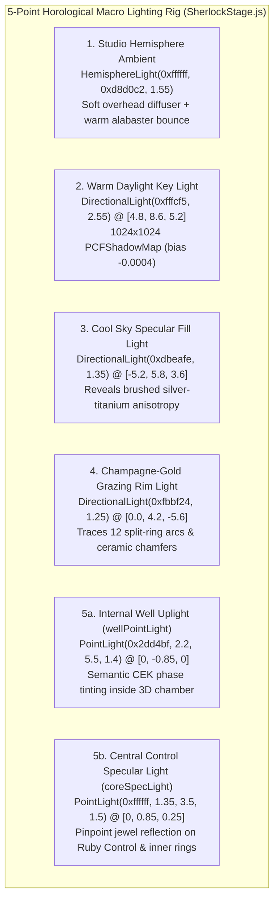

# Ring Study 06: 5-Point Horological Macro Studio Lighting Rig

## 1. Executive Design Philosophy ("Less, but better")
High-end horological macro photography (A. Lange & Söhne, Ressence, Braun, Apple Silicon die photography) relies on controlled directional contrast, complementary color-temperature fill, and acute grazing rim angles rather than flat ambient flooding or chaotic neon point lights.

To showcase the **Sherlock CEK Machine**—with its warm alabaster ceramic body, brushed silver-titanium chip deck, 6 concentric split-ring depth channels (12 arcs), and central Ruby `Control` stator—our `WebGPURenderer` stage uses a calibrated **5-Point Horological Macro Studio Lighting Rig** paired with `ACESFilmicToneMapping` at `1.18` exposure and a crisp, low-density warm paper studio atmosphere (`0xf4f0e8`, `FogExp2` density `0.024`).

---

## 2. Atmosphere, Exposure & Tone Mapping

| Parameter | Value | Rationale |
| :--- | :--- | :--- |
| `scene.background` | `0xf4f0e8` | Warm studio gallery paper backdrop that frames silver-titanium and ceramic surfaces cleanly. |
| `scene.fog` | `FogExp2(0xf4f0e8, 0.024)` | Reduced exponential fog density (`0.024` vs legacy `0.036`) so the monolithic package, split-rings, and call tiles remain razor-sharp at all camera presets. |
| `renderer.toneMapping` | `THREE.ACESFilmicToneMapping` | Compresses HDR specular peaks on metallic chamfers while preserving rich mid-tone contrast across satin titanium. |
| `renderer.toneMappingExposure` | `1.18` | Elevated studio exposure (`1.18` vs `1.08`) so brushed silver-platinum titanium and alabaster ceramic read as bright, tactile, and jewel-like. |

---

## 3. The 5-Point Horological Macro Lighting Rig

### Point 1: Studio Hemisphere Ambient (`HemisphereLight(0xffffff, 0xd8d0c2, 1.55)`)
* **Role:** Simulates an overhead museum softbox diffuser (`0xffffff`) paired with warm alabaster table bounce (`0xd8d0c2`).
* **Effect:** Prevents dark recesses inside the stepped evaluation well and titanium chamfers from crushing into muddy black while preserving directional shading.

### Point 2: Warm Daylight Key Light (`DirectionalLight(0xfffcf5, 2.55)`)
* **Position:** `[4.8, 8.6, 5.2]`
* **Shadows:** `1024×1024` `PCFShadowMap`, orthographic frustum `[-4.2, 4.2]`, `near = 1.0`, `far = 20.0`, `bias = -0.0004`.
* **Role:** Primary shape builder across the chip package, stepped well rings, and continuation wafers. Casts crisp micro-shadows into the recessed well without shadow acne.

### Point 3: Cool Sky Specular Fill Light (`DirectionalLight(0xdbeafe, 1.35)`)
* **Position:** `[-5.2, 5.8, 3.6]`
* **Role:** Positioned opposite the key light with a cool `6500K` sky tint (`0xdbeafe`).
* **Effect:** Creates silky, cool metallic reflections across the brushed silver-titanium deck and rhodium split-arcs, establishing natural warm-key vs. cool-fill color separation on anisotropic metal surfaces.

### Point 4: Champagne-Gold Grazing Rim Light (`DirectionalLight(0xfbbf24, 1.25)`)
* **Position:** `[0.0, 4.2, -5.6]`
* **Role:** Low, acute backlight skimming across the rear plane of the die toward the camera.
* **Effect:** Ignites razor-thin golden specular highlights along the chamfered edges of the 12 split-ring arcs, fuel ring segments, and ceramic bevels.

### Point 5: Dynamic Well Uplight & Control Core Overhead Specular (`wellPointLight` + `coreSpecLight`)
* **`this.wellPointLight = new THREE.PointLight(0x2dd4bf, 2.2, 5.5, 1.4)` at `[0, -0.85, 0]`:**
  * Positioned inside the hollow 3D well chamber to illuminate translucent Saved Frame Wafers (`frames: Vec<Frame>`) and the inner walls of the 6 concentric depth rings from below.
  * Dynamically tinted in `render(stepState)` via pre-allocated `this._scratchColor` with zero heap allocations:
    * `0xe11d48` (Crimson Ruby) on `ERROR`
    * `0x2dd4bf` (Teal Emerald) on `ENV` / `RESOLVE` / `RETURN` / `EMBLEM`
    * `0xfbbf24` (Warm Amber-Gold) on `OP` / `DESCEND` (default active evaluation)
* **`this.coreSpecLight = new THREE.PointLight(0xffffff, 1.35, 3.5, 1.5)` at `[0, 0.85, 0.25]`:**
  * Suspended directly above the central `Control` ruby stator and inner split-arc rings to produce a crisp, watch-crystal jewel reflection on the central control element and surrounding brass/teal ring latches.

---

## 4. Zero-Allocation WebGPU Performance Guarantees
* **Zero Per-Frame Allocations:** `this._scratchColor` (`new THREE.Color()`) and `this._fullState` are allocated once in the `SherlockStage` constructor.
* **Single Shadow-Casting Light:** Only the primary `keyLight` casts a `1024×1024` shadow map; the cool fill, grazing rim, and two point lights contribute pure analytical PBR radiance for locked 60–120 fps WebGPU frame times.
