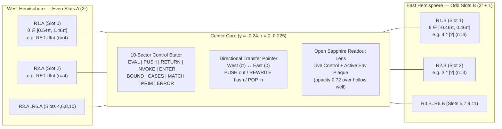

# Ring Study 08: 6 Split-Arc Semantic Rings & 10-Sector `Control` Stator Core Implementation (`designer2_well.js`)

## 1. Executive Summary: Replacing Decorative Ornament with Direct Sherlock CEK Hardware Telemetry

Earlier iterations of [`designer2_well.js`](file:///home/charles/sherlock-bench/src/designers/designer2_well.js) rendered 6 solid uninterrupted lathe-turned rings around a passive red ruby sphere (`RefractiveRubyControlCore`). While visually ornamental, that layout obscured two core truths of the frozen `sherlock-k-a/1` abstract machine in [`reference_types.rs`](file:///home/charles/sherlock-graph/crates_sherlock/reference_types.rs) and [`reference.rs`](file:///home/charles/sherlock-graph/crates_sherlock/reference.rs):

1. **Why Each Ring Must Be Split into Two Independent 180° Half-Arcs (`Slot A` West & `Slot B` East)**:
   - Because each concentric ring represents **2 continuation frames** (`12` frames total across `R1`..`R6`), an uninterrupted 360° ring conflates the two distinct frames pushed by each non-tail recursive call (`Frame::Return` at `2r` and `Frame::Right` at `2r + 1`).
   - Splitting each ring at North (`12 o'clock`) and South (`6 o'clock`) by crisp **14.4° (`0.08π` rad) architectural bridge gaps** creates **12 independent 180° Half-Ring Arcs (`R1.A, R1.B .. R6.A, R6.B`)**.
   - In `fact(4)`, every recursive activation `fact(k)` locks its **`Frame::Return(: UInt, env)`** onto the **West 180° Half-Arc (`Slot A = 2r`, Cyan-Teal `ENV`)** and its **`Frame::Right(k * [?])`** onto the **East 180° Half-Arc (`Slot B = 2r + 1`, Luminous Gold `OP`)**.
2. **Why the Passive Ruby Is Replaced by the 10-Sector `Control` Optical Stator & Live Readout Lens**:
   - A red sphere communicates almost nothing about the 10 `Control` variants of [`reference_types.rs`](file:///home/charles/sherlock-graph/crates_sherlock/reference_types.rs#L114-L126) (`Eval`, `Push`, `Return`, `Invoke`, `Enter`, `Bound`, `Cases`, `CaseResult`, `PrimitiveResult`, `Error`).
   - Replacing the ruby with a **Brushed Silver-Rhodium & Sapphire 10-Sector `Control` Stator Ring** (`innerRadius = 0.145, outerRadius = 0.225` at `y = -0.24`), a **Directional Radial Transfer Pointer (`transferNeedleGroup`)**, and a **Central Open Sapphire Live Readout Lens (`r = 0.135`, `opacity = 0.72`)** makes the `Control` register a first-class hardware instrument at the exact center of the chip.

---

## 2. Architectural Diagram: 6 Split-Arc Rings + 10-Sector `Control` Stator

---

## 3. Detailed Specification of the 10-Sector `Control` Core (`controlCoreGroup`, `y = -0.24`)

### 3.1 10-Sector Optical Stator Ring (`innerRadius = 0.145, outerRadius = 0.225`)
Suspended at the center of Ring 6 (`x = 0, z = 0, y = -0.24`) on North/South rhodium-gold bridge struts aligned with the 14.4° ring gaps:
- **10 Instanced Sector Pads (`statorSectorsInstancedMesh`)**:
  - A single `THREE.InstancedMesh` of 10 precision-chamfered annular sector pads (`0..9`) corresponding to the 10 `Control` variants of [`reference_types.rs`](file:///home/charles/sherlock-graph/crates_sherlock/reference_types.rs#L114-L126):
    `['EVAL', 'PUSH', 'RETURN', 'INVOKE', 'ENTER', 'BOUND', 'CASES', 'MATCH', 'PRIM', 'ERROR']`.
  - Paired with a crisp static 10-sector dial overlay texture (`createControlStatorDialTexture()`) engraved with radial sector ticks and variant labels.
- **Semantic Sector Colors & Elevation**:
  - **`RETURN` (`2`), `BOUND` (`5`), `MATCH` (`7`)**: **Cyan-Teal (`0x2dd4bf`)**
  - **`EVAL` (`0`), `PRIM` (`8`)**: **Luminous Gold (`0xfbbf24`)**
  - **`PUSH` (`1`), `INVOKE` (`3`), `ENTER` (`4`), `CASES` (`6`)**: **Amber (`0xf59e0b`)**
  - **`ERROR` (`9`)**: **Crimson (`0xe11d48`)**
  - On each step, the active sector (`0..9`) elevates (`y = +0.009` vs `0.002` idle) and blazes with its semantic color while inactive sectors remain calm brushed dark-sapphire slate.

### 3.2 Directional Radial Transfer Pointer (`transferNeedleGroup`)
- A champagne-gold (`0xd4af37`) pointer arm with an emissive jewel tip that rotates smoothly to target the active Half-Ring Arc:
  - **West (`θ = π`)** when targeting `Slot A` (even chronological index `2r`).
  - **East (`θ = 0`)** when targeting `Slot B` (odd chronological index `2r + 1`).
- **Radial Articulation**:
  - **Outward Pulse on `PUSH`** (`Control::Push` / Rule `A135 PushFrame`).
  - **Luminous Gold Flash on In-Place `REWRITE`** (Rules `A145 BindLet`, `A149 RightOp`, `A177 NextArg`).
  - **Inward Pull on `POP` / `RETURN`** (Rules `A153`, `A157`, `A161`, `A165`, `A173`, `A181`, `A185`, `A195`).

### 3.3 Central Open Sapphire Live Readout Lens (`r = 0.135`)
- A dark-sapphire optical glass disc (`opacity: 0.72`, keeping the hollow well and 39-rule floor below clearly visible) topped with a cached high-DPI readout plaque (`createPlaqueTexture`):
  - **Title**: Live `Control` action and expression/value, e.g., `EVAL · n * fact(n-1)`, `PUSH · Right(4 * [?])`, `RETURN · 24`, or `DONE · 24`.
  - **Subtitle**: Active rule and lexical binding, e.g., `Rule A149 · n = 4`.
  - **Badge**: `CTRL // EVAL` (or `PUSH`, `RET`, `INVOKE`, `ENTER`, `BOUND`, `CASES`, `MATCH`, `PRIM`, `DONE`, `ERR`).

---

## 4. Detailed Specification of the 6 Concentric Split-Arc Semantic Rings (`R1.A..R6.B`)

### 4.1 Spatial Stepping & Split-Arc Geometry
Each concentric ring `r ∈ 0..5` steps inward in radius and downward in elevation from `y = 0.06` to `y = -0.21`:

| Ring | West Half-Arc (`Slot A = 2r`) | East Half-Arc (`Slot B = 2r + 1`) | Base Elevation `y` | Outer Radius `outerR` | Inner Radius `innerR` | Mid Radius `midR` |
| :---: | :---: | :---: | :---: | :---: | :---: | :---: |
| **`R1`** | `R1A` (`slot 0`, `θ ∈ [0.54π, 1.46π]`) | `R1B` (`slot 1`, `θ ∈ [-0.46π, 0.46π]`) | `+0.060` | `0.950` | `0.854` | `0.902` |
| **`R2`** | `R2A` (`slot 2`, `θ ∈ [0.54π, 1.46π]`) | `R2B` (`slot 3`, `θ ∈ [-0.46π, 0.46π]`) | `+0.006` | `0.822` | `0.726` | `0.774` |
| **`R3`** | `R3A` (`slot 4`, `θ ∈ [0.54π, 1.46π]`) | `R3B` (`slot 5`, `θ ∈ [-0.46π, 0.46π]`) | `-0.048` | `0.694` | `0.598` | `0.646` |
| **`R4`** | `R4A` (`slot 6`, `θ ∈ [0.54π, 1.46π]`) | `R4B` (`slot 7`, `θ ∈ [-0.46π, 0.46π]`) | `-0.102` | `0.566` | `0.470` | `0.518` |
| **`R5`** | `R5A` (`slot 8`, `θ ∈ [0.54π, 1.46π]`) | `R5B` (`slot 9`, `θ ∈ [-0.46π, 0.46π]`) | `-0.156` | `0.438` | `0.342` | `0.390` |
| **`R6`** | `R6A` (`slot 10`, `θ ∈ [0.54π, 1.46π]`) | `R6B` (`slot 11`, `θ ∈ [-0.46π, 0.46π]`) | `-0.210` | `0.310` | `0.232` | `0.271` |

Each of the 12 Half-Arcs (`halfArcSlots[0..11]`) consists of:
1. **Brushed Silver-Rhodium Outer Arc**: Precision-beveled 180° annular arc (`thetaLength = 0.92 * Math.PI`) with closed end-caps at the 14.4° North/South bridge gaps, using `PALETTE.titaniumSilver` (`0xe2e7f0`) / `PALETTE.titanium` (`0xd8dde6`) and `createBrushedMetalTexture()`.
2. **Recessed Anodized Dark-Sapphire Inner Channel**: Matte dark-sapphire channel (`0x111827`) inset along the top face of the arc.
3. **Emissive Semantic Light-Pipe Arc**: `new THREE.TorusGeometry(midR, 0.012, 10, 36, 0.88 * Math.PI)` seated inside the dark-sapphire channel.
4. **Top-Surface Slot Micro-Plaque (`0.16 × 0.058`)**: Mounted at `θ = π` (`x = -midR, z = 0`) for West `Slot A` and `θ = 0` (`x = +midR, z = 0`) for East `Slot B`, rendered via cached `createPlaqueTexture()` (`R1A · RET:UInt (root)`, `R1B · 4 * [?] (n=4)`, or `R1A · IDLE`).

### 4.2 Semantic Color Families & Physical Articulation in `.update(stepState)`
- **3 Semantic Color Families**:
  - **`ENV` (`Return`, `Scope`)**: **Cyan-Teal (`0x2dd4bf`)** — caller environment & return type contract.
  - **`OP` (`Left`, `Right`, `Unary`, `Args`)**: **Amber-Copper (`0xf59e0b`)** while evaluating left/args (`Left`, `Args`, `Unary`), shifting to **Luminous Gold (`0xfbbf24`)** once the left value is locked into `Right` (`4 * [?]`).
  - **`GATE` (`If`, `Match`, `Let`)**: **Royal Violet-Indigo (`0x818cf8`)** — conditional branch, pattern match, or let-binding gate.
- **Physical Articulation**:
  - **Idle Half-Arc**: Recessed at `y = baseY - 0.016` with a dim slate light-pipe (`emissiveIntensity = 0.06`).
  - **Occupied Half-Arc**: Smoothly elevates to `y = baseY + 0.012` and illuminates its semantic light-pipe (`emissiveIntensity = 0.85`, or `1.45` when `isTopOfStack`).
  - **In-Place Rewrite Lock-Pulse (`Rules 145, 149, 177`)**: When the top-of-stack frame rewrites in-place without changing `frames.len()`, the active Half-Arc executes a damped rotational & vertical lock-pulse (`+0.010` elevation + `0.035 rad` twist) as its color shifts (e.g., Amber `Left` $\rightarrow$ Gold `Right` on Rule `A149`, or Violet `Let` $\rightarrow$ Cyan-Teal `Scope` on Rule `A145`).

---

## 5. WebGPU Performance & Zero-Allocation Guarantee

- **Zero Heap Allocations in `.update(stepState)`**:
  - All `THREE.Matrix4`, `THREE.Vector3`, `THREE.Quaternion`, `THREE.Euler`, and `THREE.Color` operations use module-scope scratch singletons (`_scratchMat4`, `_scratchPos`, `_scratchQuat`, `_scratchEuler`, `_scratchScale`, `_scratchColor`, `_scratchColorB`).
  - Chronological frame lookup reads `stepState.ringTelemetry` when present or indexes `frames[frames.length - 1 - slotIdx]` directly in $O(1)$ without cloning or reversing arrays per frame.
  - All 12 Half-Arc micro-plaques and the central `Control` lens plaque track their last rendered string key (`slot.lastPlaqueKey`, `lastCorePlaqueKey`) and only query the bounded LRU `createPlaqueTexture()` cache when step content changes.
- **Instanced Draw-Call Discipline**:
  - Outer 48-segment draining fuel ring: `1 THREE.InstancedMesh` (`fuelInstancedMesh`).
  - 10-sector `Control` optical stator pads: `1 THREE.InstancedMesh` (`statorSectorsInstancedMesh`).
  - 24 North/South split-arc bridge isolator clasps: `1 THREE.InstancedMesh` (`bridgeClaspsInstancedMesh`).
  - 39-rule decoder floor matrix: `1 THREE.InstancedMesh` (`ruleTilesInstancedMesh`) + `1` static 2048×2048 overlay mesh (`floorOverlayMesh`).
