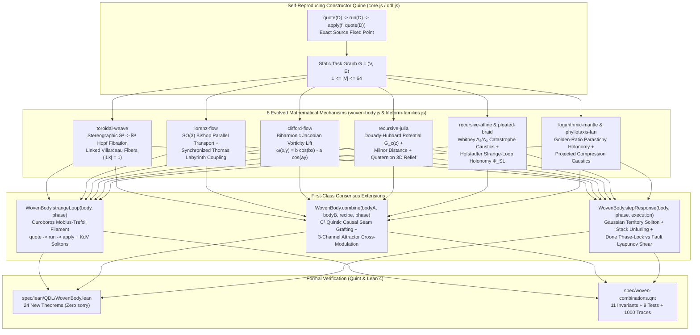

# Quinelings `wiki-llm` — Persistent Architecture, Exotic Mathematics & Formal Verification Ledger

**Last updated:** 2026-10-19  
**Provenance:** 20-Agent Multi-Model Research Council (`5 Gemini`, `5 Grok 4.7`, `5 Muse Wonder 1.0`, `5 GPT Sol 6.1`) + Upstream Quint & Lean 4 Verification  
**Primary source modules:** [`woven-body.js`](../woven-body.js), [`lifeform-families.js`](../lifeform-families.js), [`qdl-v1-offspring.js`](../qdl-v1-offspring.js), [`core.js`](../core.js), [`qdl.js`](../qdl.js), [`spec/woven-combinations.qnt`](../spec/woven-combinations.qnt), [`spec/lean/QDL/WovenBody.lean`](../spec/lean/QDL/WovenBody.lean)

---

## 1. Purpose & Scope

This directory (`wiki-llm/`) is the persistent, LLM-first architectural and mathematical knowledge base for **Quinelings**. It preserves:
1. The **20-Agent Research Council** findings ([`research/council_20/`](../research/council_20/)) across four distinct frontier model families (**Gemini**, **Grok 4.7**, **Muse Wonder 1.0**, and **GPT Sol 6.1**).
2. The **Consensus Mathematical & Morphological Enhancements** ([`CONSENSUS-2026-10-19.md`](CONSENSUS-2026-10-19.md)) that evolve Quinelings' chaos, fractal, and strange-loop foundations with exotic differential geometry, complex/quaternionic dynamics, symbiogenetic chimeric combinations, and live program-execution coupling.
3. The **Formal Verification Ledger** ([`05-quint-and-lean4-formal-proofs.md`](05-quint-and-lean4-formal-proofs.md)) linking every mathematical invariant to machine-checked **Lean 4 theorems** (`spec/lean/QDL/WovenBody.lean`) and **Quint state-machine specifications** (`spec/woven-combinations.qnt`, `spec/design.qnt`, `spec/ranch.qnt`).

It complements—and never weakens—the existing validation and verification contracts (`verify.cjs`, `verify-v1.cjs`, `verify-v1-offspring.cjs`, `tests/verify-woven-body.cjs`, `tests/verify-lifeform-families.cjs`, `tests/verify-visual-capsule.cjs`, and `scripts/check-lean.sh`).

---

## 2. Navigation Index

| Document | Core Focus | Key Symbols & Theorems |
| :--- | :--- | :--- |
| [**`CONSENSUS-2026-10-19.md`**](CONSENSUS-2026-10-19.md) | Executive 20-agent consensus matrix, API additions, parameter bounds & verification summary | `WovenBody.strangeLoop`, `WovenBody.combine`, `WovenBody.authorCombination`, `WovenBody.stepResponse`, `QDL.WovenBody` |
| [**`01-exotic-math-and-chaos.md`**](01-exotic-math-and-chaos.md) | Stereographic $S^3 \to \mathbb{R}^3$ Hopf Fibration, Bishop $\mathrm{SO}(3)$ parallel-transport torsion frames, Lorenz–Thomas biharmonic coupling, Clifford vorticity lift, and Hofstadter strange-loop holonomy | `compileLorenzBishop`, `lorenzSpine`, `hopfDenom`, $\Phi_{\text{SL}}(u,k,p)$, `hopf_s3_unit_norm` |
| [**`02-fractals-and-strangeloop-quines.md`**](02-fractals-and-strangeloop-quines.md) | 3D Quaternion/Bicomplex Douady–Hubbard holomorphic potential $G_c(z)$, Milnor distance $d(z,\mathcal{J}_c)$, Whitney $A_2/A_3$ catastrophe caustics, and the Ouroboros `quote -> run -> apply` feedback manifold | `juliaValue`, `juliaWarp`, `WovenBody.strangeLoop`, `recursiveScrollSingularityGain` |
| [**`03-chimeric-combinations.md`**](03-chimeric-combinations.md) | Symbiogenesis, multi-mechanism combinations (`compose`, `mate`, `merge`, `symbiote`, `body`), $C^2$ quintic seam grafting, and 3-channel attractor cross-modulation | `WovenBody.combine`, `WovenBody.authorCombination`, `WovenBody.validateChimera`, `universalChartPoint`, `invariantSignal` |
| [**`04-program-execution-response.md`**](04-program-execution-response.md) | Live step-by-step CEK & QDL task execution coupling: active-node Gaussian soliton waves, recursion-depth branch/whorl unfurling, fuel pacing, and terminal outcome regimes (`Done`, `Rejected`, `Exhausted`) | `WovenBody.normalizeExecution`, `WovenBody.stepResponse`, `WovenBody.frame(..., { execution })` |
| [**`05-quint-and-lean4-formal-proofs.md`**](05-quint-and-lean4-formal-proofs.md) | Machine-checked Lean 4 mathematical proofs (`spec/lean/QDL/WovenBody.lean`, 107 total QDL theorems) and Quint state-machine verification (`spec/woven-combinations.qnt`) | `strand_territory_coverage`, `branchReach_envelope_bound`, `hopf_s3_unit_norm`, `clifford_step_abs_bound`, `chimericSeam_quintic_enclosure`, `clampedExecutionOpacity_bounds` |

---

## 3. 20-Agent Research Council Roster & Raw Reports

All raw reports produced by the 20-agent council are archived under [`../research/council_20/`](../research/council_20/):

| Track | Specialization | Gemini Report | Grok 4.7 Report | Muse Wonder (`muse-wonder-1.0`) Report | GPT Sol 6.1 (`gpt-6.1-sol`) Report |
| :--- | :--- | :--- | :--- | :--- | :--- |
| **Track 1** | **Exotic Strange Attractors, Chaotic Flows & Differential Geometry** | [`gemini_01_exotic_math.md`](../research/council_20/gemini_01_exotic_math.md) | [`grok_01_exotic_math.md`](../research/council_20/grok_01_exotic_math.md) | [`muse_01_exotic_math.md`](../research/council_20/muse_01_exotic_math.md) | [`sol_01_exotic_math.md`](../research/council_20/sol_01_exotic_math.md) |
| **Track 2** | **Higher-Order Fractals, Complex Dynamics & Strange-Loop Self-Reference** | [`gemini_02_fractals_strangeloop.md`](../research/council_20/gemini_02_fractals_strangeloop.md) | [`grok_02_fractals_strangeloop.md`](../research/council_20/grok_02_fractals_strangeloop.md) | [`muse_02_fractals_strangeloop.md`](../research/council_20/muse_02_fractals_strangeloop.md) | [`sol_02_fractals_strangeloop.md`](../research/council_20/sol_02_fractals_strangeloop.md) |
| **Track 3** | **Symbiogenesis, Chimeric Combinations & Multi-Mechanism Offspring** | [`gemini_03_combinations.md`](../research/council_20/gemini_03_combinations.md) | [`grok_03_combinations.md`](../research/council_20/grok_03_combinations.md) | [`muse_03_combinations.md`](../research/council_20/muse_03_combinations.md) | [`sol_03_combinations.md`](../research/council_20/sol_03_combinations.md) |
| **Track 4** | **Live Program Execution Coupling & CEK / Task Trace Response** | [`gemini_04_program_execution.md`](../research/council_20/gemini_04_program_execution.md) | [`grok_04_program_execution.md`](../research/council_20/grok_04_program_execution.md) | [`muse_04_program_execution.md`](../research/council_20/muse_04_program_execution.md) | [`sol_04_program_execution.md`](../research/council_20/sol_04_program_execution.md) |
| **Track 5** | **Formal Verification in Quint & Mathematical Theorem Proving in Lean 4** | [`gemini_05_quint_lean_proofs.md`](../research/council_20/gemini_05_quint_lean_proofs.md) | [`grok_05_quint_lean_proofs.md`](../research/council_20/grok_05_quint_lean_proofs.md) | [`muse_05_quint_lean_proofs.md`](../research/council_20/muse_05_quint_lean_proofs.md) | [`sol_05_quint_lean_proofs.md`](../research/council_20/sol_05_quint_lean_proofs.md) |

---

## 4. Architectural Map of Evolved Quinelings

